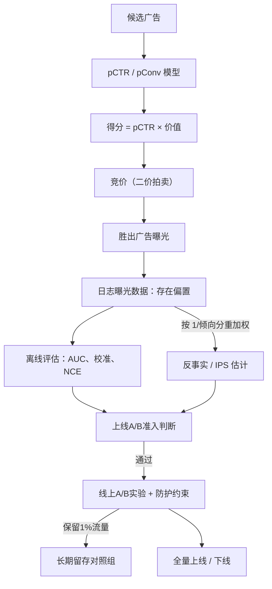

# 为广告排序系统设计一套评估框架
任何人都能训练一个pCTR（预估点击率）模型。难点在于：在改动影响收入之前，证明这个改动是有效的。模型运行在竞价体系中，日志里只记录竞价胜出、最终被展示的广告，而且仅仅1%的预估偏差，都会直接对应真金白银的盈亏。这是一道**评估问题**，不是建模问题。

> 一句话摘要（TL;DR）：分三层评估。离线阶段重点校验**校准度**与NCE/对数损失，不能只看AUC，因为预估概率会直接输入竞价出价；线上做A/B实验，设置收入和用户体验的防护指标，同时保留长期隔离流量组；还要修正一个核心问题：日志里只有竞价获胜广告，存在选择偏差，需要用反事实/逆倾向得分（IPS）做校正，简单粗暴的离线回放会偏向旧模型原本展示过的广告。

## 解题思路
首先转换思考角度：面试官不是让你搭建pCTR模型，而是问你如何判断一次改动是否正向。答案是一套从离线到线上的完整评估链路，这套链路要适配广告业务和信息流推荐两个关键差异：
1. 模型输出是概率值，这个概率会和广告主价值相乘，算出竞价出价（在常见的二价拍卖中：`出价 = pCTR × 广告主价值`）。所以预估结果**校准好坏**，和排序效果同等重要；如果系统性高估5%，会造成向广告主过度收费，扰乱整个广告市场。
2. 训练、评估日志只包含竞价成功、被曝光的广告，数据本身就被你要评估的这套系统筛选过，自带选择偏差。
回答需要覆盖：离线指标、竞价交互逻辑、反事实偏差问题、带防护指标的线上实验。

## 高分回答
离线评估是低成本、快速的第一道关卡，指标组合是关键。
AUC衡量排序能力（模型能不能把点击样本排在无点击样本前面），它是必要条件，但远远不够：两个AUC完全一样的模型，预估校准度可能天差地别。
所以离线核心指标是**校准度**和NCE（归一化交叉熵），NCE是对数损失相对于基准点击率的指标，是广告领域的标准指标，用来衡量模型相比“直接用平均点击率预估”能提升多少。
校准度既要做全局校验（全部曝光里，预估点击率 vs 真实点击率），也要分切片校验（按广告主、展示位、人群、设备拆分）：模型整体校准没问题，但某一个高收入细分群体严重失准，依然会造成巨大损失。
对数损失、PR-AUC用来补充评估，适配广告里极端的类别不平衡（点击是极少数样本）。

| 评估层级 | 指标 | 它能说明什么 | 它无法说明什么 |
| ---- | ---- | ---- | ---- |
| 离线 | AUC / PR-AUC | 排序质量、样本先后顺序 | 预估概率本身准不准 |
| 离线 | 校准度（ECE、可靠性）、NCE、对数损失 | 预估概率是否贴合真实；相比基线是否有提升 | 对收入、用户产生的因果效果 |
| 反事实评估 | IPS / 加权回放 | 基于历史日志，预估上线后的效果 | 日志记录之外的广告动作空间 |
| 线上 | A/B实验：每会话收入、CTR + 防护指标 | 真实的因果效果 | 长期效应、市场网络效应（需要隔离流量组） |

竞价交互这个点，是只做过普通分类任务的人很容易踩坑的地方：
模型并不直接决定展示什么广告；模型的预估值会输入出价，由竞价机制决定最终结果。所以一个单独看排序更好的模型，如果校准发生偏移、改变了出价分布，最终反而会造成收入下跌。不能孤立评估模型，必须评估**模型+竞价整套系统**。
这也是离线回放有风险的原因：拿新模型去打分旧日志，你只有曾经胜出广告的标签；对于旧模型从来没有曝光过的广告，你完全不知道它如果被展示，会带来什么结果。

这就是**反事实问题**。日志数据只是全部可选广告空间里的一个有偏样本。直接简单回放日志、统计点击，会高估旧策略原本偏好的广告。
解决方案是逆倾向得分（IPS）。下面用两条广告的例子解释原理与代价（数值经过验算）：
旧策略有90%概率投放广告A（观测点击率2%），10%概率投放广告B（观测点击率4%）。现在你想评估一个永远投放广告B的新策略。
旧策略平均点击率是 `0.9 × 2% + 0.1 × 4% = 2.2%`，这个数字完全不能代表新策略效果。
IPS的做法：在全部N条历史曝光样本上做加权平均，每一条广告B的点击，权重是 `1/0.1 = 10`；广告A样本权重记为0。
公式：`(1/N) × Σ [展示B的样本 × 点击 / 0.1]`，期望结果等于4%，也就是全量投放B的策略真实点击率。
⚠️ 注意：不能只拿加权后的B样本直接平均，那样会算出40%；分母必须是全部N条样本。
在这个简单案例里，9:1的投放比例固定随机，直接取B样本平均也刚好得到4%；IPS真正的价值，是当旧策略的投放选择和上下文强相关时依然有效。
但IPS有代价：**方差很大**。评估结果完全依赖占比10%的数据，再放大10倍，低频动作的估计噪声极高。这也是双重稳健估计器被提出的原因，同时也说明探索流量不能太小。
如果广告B的倾向概率等于0，再怎么加权都无法估计——这句话就证明了：**必须保留随机探索流量，这不是锦上添花，是必备前提**。

对应的工程要求也很明确：
在曝光发生的同时，把本次投放的倾向概率一并存入日志（倾向概率事后无法重建）；持续保留一小部分随机探索流量，保证任意一个合理候选广告的倾向概率不会变成0。
反事实评估比单纯离线指标更适合作为“能不能进A/B实验”的闸门，但它依然只是预估，不是最终结论。

线上实验才是最终判决。广告场景里防护指标的取舍非常明确：核心指标是收入，但收入可以靠牺牲用户体验短期堆出来。
所以A/B实验跟踪**每会话（或每一次请求）收入**，同时设置用户侧防护红线：广告加载量、广告屏蔽/举报率、自然内容互动量、长期留存。
一个改动哪怕短期收入涨2%，但屏蔽率上升、会话量下滑，本质是负向的。广告收入是长期生意，过度商业化会流失用户。
对于两周A/B实验看不到的长期效应和市场网络效应（广告主会跟着调整出价、用户会慢慢习惯广告），我们单独拿出一小部分流量（通常1%）长期隔离，几个月内不应用任何广告侧改动，在这个隔离组里衡量累积长期影响。
同时还要监控广告主侧健康度：广告投放量、转化成本稳定性。广告市场是双边市场，广告主收益受损，最终也会反映成平台收入下滑。

总结：这套分层框架是刻意设计的。
离线校准+NCE是快速、低成本的初筛；反事实/IPS在校正选择偏差的前提下预估线上效果；带收入-体验防护指标、搭配长期隔离组的A/B实验，才是上线的最终依据。
如果有人只回答“看AUC”，说明他没意识到：模型嵌套在竞价系统里、日志存在偏差、真正要关心的是因果效应。

---
## 面试官后续深挖的问题
- 面试官：AUC涨了，可以直接上线吗？
  回答：不可以。AUC只衡量排序。如果校准变差，出价就会出错，竞价定价失真，哪怕排序更好也可能亏钱。先看校准度、NCE，再看反事实评估结果，最后走A/B。
- 面试官：日志里只有竞价赢下的广告，这会给离线评估带来什么影响？
  回答：数据存在选择偏差，偏向旧模型曾经展示的广告。直接回放会高估原有策略。我们要记录倾向概率、保留探索流量，使用IPS（搭配降方差的模型校正）得到无偏的反事实估计。
- 面试官：A/B实验里收入涨了2%，直接上线？
  回答：只有用户防护指标（屏蔽率、广告负载、会话量、留存）和广告主健康指标全部稳住，并且最好长期隔离组验证这个收益不是短期习惯效应、后续不会回落，才可以上线。靠透支用户体验换来的短期收入，后续一定会反转。

## 常见错误
1. 把AUC当成终极目标，忽略校准度——但预估值是要用来计算竞价出价的；
2. 把模型当成独立分类器评估，忘记它服务于竞价系统；
3. 直接回放日志，当成无偏样本，无视日志里只有竞价胜出广告；
4. 不记录倾向概率、不留探索流量，导致完全无法做反事实评估；
5. 只看线上收入，没有用户体验、广告主健康的防护指标；
6. 仅凭两周A/B实验就宣布胜利，忽略出价调整、用户适应这类需要几个月才能显现的真实影响，这类影响只能靠长期隔离流量组观测。

## 核心要点
- 离线阶段：校准度、NCE和AUC同等重要，因为预估概率会输入竞价出价；校准不能只看全局，必须分切片校验；
- 模型不是独立分类器，它嵌入竞价流程，要评估【模型+竞价】整套系统；
- 日志存在选择偏差，只记录竞价胜出广告；要记录倾向概率、保留探索流量，用IPS/双重稳健估计做无偏反事实评估；
- 线上A/B是最终判决，必须同时权衡收入和用户体验防护指标，搭配长期隔离组捕捉短期实验看不到的长期效应。

---
## 编者注
这个问题能区分两类候选人：一类是真正落地过广告系统的，一类只是读过逻辑回归理论的。
判断标准是候选人能否给出完整评估链路：离线重视校准度、NCE（而不只是AUC）；线上A/B平衡收入和用户体验；明白模型嵌套在竞价中，简单离线回放存在偏差；会用反事实/IPS或者隔离流量组，处理日志数据的选择偏差。
面试官经常追加提问：**AUC涨了，你会上线吗？**、**日志里只有竞价获胜广告，对你的离线评估有什么影响？**

### 讨论区
> 分享你的思路、你被追问的后续问题，或是真实业务落地的经验……
>
> @mei（编辑）·13小时前
> IPS的前置条件是【随机探索流量】，IPS本身不是前提。很多候选人可以流利说出逆倾向得分，但答不出：旧模型从来没展示过的广告，它的倾向概率从哪里来？
> 诚实的答案是：如果没有日志里的随机探索切片，这些广告的倾向概率等于0，IPS根本无法评估这个动作。所以探索流量预算，是整套反事实评估链路能跑起来的根基。

---
### 流程图翻译
1. 候选广告 → pCTR / p转化模型 → `得分 = pCTR × 广告价值` → 竞价（二价拍卖）→ 胜出广告曝光 → 有偏的曝光日志
2. 日志分两条分支：
   - 离线评估：AUC、校准度、NCE
   - 反事实/IPS评估：按 `1/倾向概率` 加权
3. 两个评估结果汇入判断节点：是否进入A/B实验
   - 不通过：拦截
   - 通过：进入线上A/B实验 + 防护指标监控
4. A/B结果分流：
   - 分出1%流量长期隔离（长期观测组）
   - 其余：决定上线 / 回滚

如果你需要，我可以帮你整理成面试口述精简版，方便直接背诵。