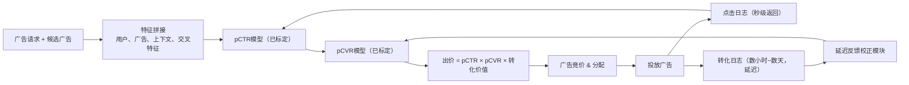

# 广告点击率（CTR）与转化率（CVR）预估系统设计
> 这个模型的输出不是排序结果，而是竞价的价格输入。标定不准的CTR会造成竞价出错，进而导致出价过高或者投放不足。再加上点击数天后才会发生转化、以及毫无历史数据的广告主这类场景，**标定能力 + 延迟反馈问题**就成为这个面试题的核心考察点。
> 更新于2026年8月 · 基于真实的Forward Deployed Engineer面试流程整理，按照资深工程师的标准撰写
> ML系统设计（产品方向）第6题，一共12题 · 全部600+ FDE面试题
> 更多题目 ↓

---
## 06 设计广告CTR、CVR预估系统
难度：Hard | 考察公司：Google、Meta、Amazon
2条回答 · 已解锁

**一句话总结（TL;DR）**
分别训练两个经过标定的模型来预估pCTR（预估点击率）和pCVR（预估转化率），两者相乘的结果作为广告竞价的期望价值出价。因此**标定能力（而不只是排序能力）是核心要求**。使用延迟反馈模型处理滞后的转化数据：把“到目前为止还未转化”的点击样本当成**删失样本（censored）**，而直接标记为负样本；针对新广告、新广告主的冷启动问题，使用内容特征、分层先验信息，搭配探索策略；上线发布时，设置花费防护阈值，以线上收益、ROI指标作为校验。

## 解题思路
先明确预估目标：在每次曝光的广告竞价中，一条广告的出价大致满足公式：
`出价 ≈ pCTR × pCVR × 广告主单转化价值`
这些概率值是用来定价的，而不只是用来排序。仅此一点就改变了优先级：**标定的重要性和区分能力（排序效果）同等重要**。一个排序效果完美、但概率绝对值偏差2倍的模型，会系统性地给出错误出价。

先澄清约束：
1. 延迟要求：单次请求需要给数百到数千条候选广告打分，延迟需要控制在几十毫秒内；
2. 转化定义与归因窗口期：点击后7天内下单，和会话内加购，是完全不同的标签；
3. 新广告、新广告主源源不断接入系统。

之后分两大模块设计：CTR模型、CVR模型，**标定、延迟反馈是一等优先级问题**。

## 高分回答
漏斗拆成两个独立模型训练，因为两者的条件分布、反馈时间完全不一样：
- pCTR = P(点击 | 曝光)：基于曝光日志训练，标签在曝光后数秒内就可以拿到；
- pCVR = P(转化 | 点击)：只在点击样本上训练（点击是这个子任务的“曝光”），转化标签可能在几分钟、甚至数天后才返回。

两者相乘得到**单次曝光的期望转化数**，广告竞价模块基于这个值计算出价。分开建模的好处：两个任务可以各自使用独立特征、独立去偏方案；同时避免稀疏的转化信号，被数量庞大的点击样本稀释淹没。

### Mermaid流程图

### 标定（Calibration）是重中之重
因为出价是概率的函数，我们要优化**绝对误差**，而不仅仅是排序。
训练时先用logistic损失，之后叠加显式标定层：Platt缩放或者保序回归（isotonic regression）。
需要按各个核心分片（设备、行业、国家）监控期望标定误差ECE、可靠性曲线。全局标定正常，也可能隐藏分片层面的偏差，导致某一类广告主全部定价出错。

同时需要按广告位/位置单独标定：同一条广告放在不同位置，CTR天然不一样。位置偏差既是去偏问题（位置偏差模型、逆概率加权IPW），也是标定问题。
AUC、logloss都要上报，但是**标定指标是上线卡点指标**。

举一个真实的错价案例（可以直观理解“标定就是收益”）：
真实pCTR=1%，真实pCVR=5%，广告主愿意为一次转化支付50美元。
这条曝光真实期望价值：`0.01 × 0.05 × 50 = 0.025美元`，这也是合理出价上限。
如果模型排序不变，但是pCTR预测值放大2倍，模型评估这条曝光价值0.05美元。在二价竞价中，只要对手出价落在0.025~0.05之间，我们都会赢得曝光，但是每一次出价都高于曝光本身真实价值。
排序指标AUC完全看不出问题——AUC只比较样本相对顺序，所有概率同时翻倍，样本相对顺序不变。
这个损害在线下离线实验里无法发现，线上现象是消耗上涨、ROI下滑；而且偏差往往只出现在部分分片（某个国家、某类设备），全局可靠性曲线看起来正常。
这就是为什么我们需要按分片监控ECE，也对应这个经典面试追问：AUC涨了，收入反而下跌，该怎么排查。

### 延迟反馈：CVR模型最核心的难点
我们不能等完整归因窗口结束再训练模型，流量、创意迭代速度太快；
但如果把**还没有产生转化的点击直接标记为负样本**，会系统性低估CVR（很多点击会在之后转化）。
这类标签属于**删失样本（censored），不是负样本**。

标准方案：延迟反馈模型
联合建模两个分布：转化概率、转化延迟分布（例如指数分布描述点击到转化的间隔）。
对于一条刚产生、还没有转化的点击，模型理解为“未来仍有可能转化”，而不是直接判定为负样本；同时使用重要性加权，对损失做校正。

工程落地：使用滑动窗口高频重训；当延迟的转化数据陆续回来后，重新回溯修正标签。
归因窗口本身也要权衡：窗口太短会丢失真实转化；窗口太长会拖慢学习速度、增加测量复杂度。

### 特征与交叉特征
- 用户侧：历史行为、兴趣、近期意图信号
- 广告/广告主侧：创意Embedding、类目、经过平滑的历史CTR/CVR
- 上下文侧：搜索词/页面、设备、广告位、时段

收益最高的是**特征交叉**：用户×广告类目、搜索词×创意、地域×行业。
传统系统用大规模稀疏LR、因子机学习交叉；现代系统使用Embedding + 深度交叉网络（DCN / DeepFM），自动学习交叉特征，而不是人工枚举。
对高基数ID做哈希处理，防止交叉特征把特征空间撑爆。

### 冷启动问题
冷启动问题非常棘手：新广告定价出错会直接浪费预算。一条全新广告/广告主，没有任何点击、转化数据，但第一次曝光就需要给出预估概率。

| 冷启动场景 | 输出策略 | 实现机制 |
| ---- | ---- | ---- |
| 新创意、广告主已知 | 复用广告主/类目的先验值 | 分层/经验贝叶斯平滑：广告→计划→广告主→类目层级向上借用统计先验 |
| 全新广告主 | 基于内容做预估 | 创意、落地页Embedding，检索相似广告主做预估 |
| 任意全新实体 | 让样本自行积累数据 | 独立探索预算（ε-贪心、汤普森采样Thompson sampling），保证新广告拿到无偏曝光，而不是直接饿死 |

> 探索策略是区分资深候选人的关键点：只做纯利用（exploit）的策略，永远不给新广告拿到验证效果所需要的曝光，优质新广告会直接消亡。探索需要单独预算、设置消耗上限，防止劣质新广告在学习阶段疯狂烧钱。

### 线上评估 & 反馈闭环
离线阶段：在留出数据集上优化logloss、标定误差、AUC；
线上阶段：A/B实验看和收益直接相关指标：千次曝光收益、广告主ROI/ROAS、总转化量；同时设置防护阈值（护栏指标）：用户体验（广告加载延迟）、相关性、屏蔽/投诉率、广告主投放公平性、预算控速。

这个反馈闭环是自强化的：模型决定展示哪些广告，这些展示又变成第二天的训练数据。预估偏低的优质广告拿不到曝光，永远没有机会修正偏低的预估。
探索策略 + 倾向性日志（propensity logging）保证闭环无偏。
同时要警惕风险：只优化短期点击率，会损害广告主长期ROI，导致广告主流失；所以出价由CVR和下游价值决定，而不是只看CTR。

## 面试官高频追问
1. 问：一个完全没有历史的新广告主，第一次曝光的时候，你给出什么样的pCVR？
答：基于内容和先验的预估值（创意/落地页Embedding、相似广告主、类目分层平滑先验），搭配带消耗上限的探索预算，让广告在可控成本下收集标定好的真实数据。

2. 问：为什么在这里，标定比普通分类任务重要得多？
答：这个概率是竞价的输入价格，而不只是排序key。2倍的标定误差会让每一次曝光出价出错。我们需要加入保序回归/Platt标定，并且按分片监控ECE。

3. 问：转化要延迟好几天才能拿到标签，CVR怎么训练？
答：暂时没有转化的点击标记为删失样本，不是负样本；使用延迟反馈模型，联合预估转化概率和转化延迟；滑动窗口高频训练，转化数据到达之后回溯重打标签校正。

4. 问：AUC上涨了，但是收入下跌，是什么原因？
答：AUC衡量排序好坏，不衡量定价。大概率是标定偏移（分片层面）。就算样本相对顺序变好，出价依然偏高/偏低。需要按分片查看可靠性曲线。

## 常见错误
- 只优化AUC，完全不提标定：但模型输出是竞价输入；
- 把还没转化的点击直接标负样本，低估pCVR，忽略延迟反馈；
- CTR、CVR合并成单模型，稀有转化信号被稀释；
- 没有冷启动方案：新广告定价错误，或者没有探索流量直接拿不到数据；
- 忽略位置偏差，排序、标定同时被污染；
- 只做离线评估：竞价交互、反馈闭环决定了，只有线上A/B实验看收益、广告主ROI，才能验证真实效果。

## 核心要点总结
1. 预估结果用来定价（出价 ~ pCTR × pCVR × 价值），所以按分片ECE监控的标定能力，和AUC同等关键；
2. 两阶段建模：pCTR基于曝光样本，pCVR只在点击样本训练，不要合并；
3. 转化存在延迟：使用延迟反馈模型，删失样本处理，不能直接标负；
4. 新广告/广告主冷启动：内容特征 + 分层先验，搭配带消耗上限的探索流量；上线用收益、ROI做判断，同时增加用户体验、预算控速防护护栏。

> 资深工程师的核心判断标准：理解标定在这里是硬性要求，pCTR/pCVR直接驱动竞价期望出价，一个排序很好、概率绝对值偏差一倍的模型会错误定价所有曝光。优秀候选人会把CTR/CVR拆成两个模型，正面解决延迟转化反馈（不能等标签，未转化是删失而不是负样本），并且给出完整的新广告、新广告主冷启动方案。
> 不及格回答：只优化AUC，不提标定、不提竞价逻辑。面试官经典追问：一个全新广告主，第一次曝光，你输出多少pCVR？

---

一个拉开差距的跟进问题：请描述创意刚上线第一个小时内，延迟反馈模型本身存在什么偏差。
在延迟分布拿到足够多成熟样本之前，校正项本身就有很大不确定性，此时pCVR同时面临冷启动稀疏 + 删失延迟两个问题。资深候选人的做法：在这个阶段，精准放大探索消耗上限，而不是信任还不成熟的校正结果。

很多人会遗忘：作为上线卡点的标定指标是**分片ECE**。往往造成广告主流失的定价偏差，藏在很小的分片里（新赛道、新地域），全局ECE看起来完全正常。
除了设备，还要按消耗档位切片看可靠性曲线；收益往往来自长尾分片，偏差就藏在这里。

