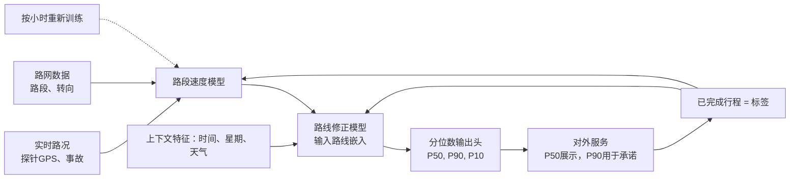

# 为地图/导航应用设计ETA（预计到达时间）预测系统
> 说明：ETA本质是一种承诺。这个面试题的核心考察点：你是把它建模成一个单点估计（预测错了之后再道歉），还是建模成一个分布——用P90分位数做到保守预估、留有余量；以及你如何把实时路况和已完成行程的数据回流到模型里。

---
## 07 为地图或导航App设计ETA预测系统

> TL;DR（一句话摘要）：预测行程耗时的分布，而不是单个数字：**P50用于页面展示ETA，P90用于承诺类场景（配送时间窗口、“抵达截止时间”）**。因为均值准确的ETA，有一半概率会迟到。基于路段、路线特征做分位数回归，融合实时路况，对分位数做校准；每一笔完成的行程都会作为新标签，形成闭环反馈。

### 思考切入点
核心思路转变：不要只做单点值预估。ETA是用来对外承诺的，迟到5分钟带来的代价，和早到5分钟的代价完全不对称；合适的建模目标是**预测分布**，从分布上读取各个分位数。
首先厘清使用场景：行程中实时更新的逐转向ETA，和下单页一次性展示的配送承诺窗口，二者不是一回事。要先明确使用者的优化目标（司机路线规划、骑手派单、给用户展示送达窗口），这决定了你选用哪个分位数、以及特征允许的滞后程度。
之后再选择建模方案：是路段级建模，还是整条路线级建模；梳理静态特征、实时特征；同时定义离线评估指标和线上熔断保护机制。

### 高分回答
用**分位数回归**对行程耗时建模。训练一个模型（梯度提升树，或者带路线编码器的深度网络），使用弹球损失（pinball loss）同时输出P50、P90、P10。
页面对外展示的ETA用P50；业务承诺指标（DoorDash配送窗口、“务必抵达”保证）使用接近P90的值，保证大约90%的情况都能提前到达。这种保守预估不是悲观，而是匹配不对称成本：骑手迟到会流失用户，骑手早到却不会带来损失。

设计上最核心的矛盾点：**路段级建模 VS 整条路线建模**
一条路线是一串连续道路路段。简单方案是单独预测每个路段耗时，再全部相加求和。
路段模型的优点：可复用、可缓存、任意路线都可以拼接组合；
但缺陷：直接相加独立路段的预测值，会忽略路线内的相关性（比如一场暴雨会同时拖慢所有路段）；转向、汇流、红绿灯带来的额外耗时，不属于某一个单独路段；**并且分位数不能直接相加（总和的P90 ≠ 各路段P90之和）**。

更优的混合方案：
基础层：路网图上的**路段速度模型**；
叠加层：**路线级修正模型**：输入路线嵌入向量（路段序列、转向数量、路口数量、道路等级切换等信息），预测残差和整条路线的分位数分布区间。
图结构很关键：路段是节点，路段之间的连通关系是边；可以用图神经网络、或者学习路段嵌入向量，捕捉一个路段的车速会受上游、相邻路段影响这个规律。

> “分位数不能直接相加”可以用一个模拟例子辅助理解，这个例子直接决定架构选型（20万次模拟，实测数据）
举例子：2个路段，平均耗时都是300秒，分布范围一样，每个路段P90≈377秒。
如果直接把两个P90相加：377+377 = 754秒。
- 假设两段延误相互独立：真实总耗时的P90是709秒。直接相加P90的结果保守了45秒；因为两个路段同时出现极端延误的概率很低。
- 假设两段有共同冲击（比如暴雨同时影响两段路）：总耗时P90会回到755秒附近。

这说明：单纯路段拼接的方案，误差方向会随环境变化：晴天的时候过度保守，暴雨的时候刚好接近真实值。不存在一个固定修正系数去解决这种正负摇摆。这正是我们需要路线级模型的理由——它能看到共同的环境上下文，直接预测整条路线的分位数分布。

特征分为三大类：
1. **静态道路特征**：路段长度、道路等级、限速、车道数、停止标志/红绿灯数量、按星期+时段统计的历史车速（单特征里效果最强）
2. **实时路况特征**：每个路段探针GPS回传的当前观测车速、事故封路数据、天气、短期路况预测。因为一趟40分钟的行程，我们关心的是**车辆抵达该路段那一刻的车速，而不是当下这一刻的车速**
3. **行程上下文特征**：交通工具类型（电动车骑手和小车，在同一路段耗时规律完全不同）、出发时间；配送场景还要加上门店备餐时长、停车交接时长——这两项往往是方差最大的来源，完全独立于道路路网本身。

标签来源：已经完成行程里记录的路段/路线实际通行时间。标签几乎零成本、源源不断：每一趟跑完的行程都是一条训练样本，不需要人工标注。这就是闭环反馈的核心。
⚠️ 需要注意幸存者偏差：我们只能拿到司机**实际选择走的路线**的耗时；很少被推荐的路线，样本非常稀疏。

**离线评估：按分位数分别评估，不能只用单一指标**
- 中位数P50：使用MAPE、RMSE评估；
- 高分位数（P90）：重点评估**校准度**：最终按时抵达的行程占比，应该接近90%。如果只有70%，说明承诺窗口有三倍概率迟到。
- 分切片统计：短途/长途、城市密集区/高速、高峰/平峰分开看指标。一个在高速上表现很好的模型，放到市中心可能完全失效。

**线上评估：做A/B实验，关注业务结果指标，而不只是误差**
承诺窗口的迟到率、用户反馈迟到、重新规划路线、取消订单率。

**熔断保护（自动回退机制 Guardrails）**
- P90失准率突然飙升；
- 某大城市的绝对误差大幅上涨；
- ETA剧烈抖动：频繁跳变的ETA，比稳定但略有偏差的ETA更容易让用户失去信任。
所以行程内更新要做平滑，限制单次ETA的最大变动幅度。

| 关注点 | 单点（均值）模型 | 分位数模型 |
| ---- | ---- | ---- |
| 展示给用户的ETA | 没有单独P50；均值会被长尾大延误拉高 | 使用P50，对极端长尾路况鲁棒 |
| 配送承诺 | 天然有大约50%概率迟到 | 使用P90，约90%情况可以早到 |
| 优化目标 | 平均误差最小 | 你对外承诺的分位数的校准覆盖率 |
| 隐藏缺陷 | 不对称的迟到成本完全无法体现 | P90失准率可以直接作为熔断指标 |

冷启动分两种场景：
1. 新路段，没有历史通行数据：回退到同道路等级先验（限速 × 等级系数），同时借助图嵌入，参考相邻路段车速，直到积累行程样本。
2. 新城市：使用全局基础模型 + 相似城市迁移学习，城市本身作为特征；在本地数据积累前，收紧承诺策略（加宽分位数区间、额外增加缓冲时长）。

延迟约束是硬性要求：路线ETA计算必须在路由接口的超时内返回，几十毫秒级别。所以路段级预测按计划预计算、缓存；只有路线修正头，在请求的时候实时运行。

### 面试官后续常追问的问题
- 问：我的P90有25%的情况不准了？
  答：这是**校准失效**，不只是单纯不准。用最近的预留行程样本重新校准高分位数；同时排查是不是备餐、交接这类路网外的方差项没有被建模。
- 问：突发事故、车道被撞封闭，怎么处理？
  答：事故、探针车速特征要近实时流入，行程内ETA重新预测；但更新要做平滑，不能一次跳变12分钟。用**预测车速特征**，而不是只盯着当下瞬时车速反应。
- 问：为什么不直接累加各个路段的预测值？
  答：忽略了路线内相关性，并且分位数不能相加；路线级修正 + 路线嵌入，可以捕捉转向、汇流耗时、所有路段共同减速这类路段求和无法捕获的信息。
- 问：模型多久更新一次才算新鲜？
  答：路段实时特征1~2分钟更新一次；模型按小时到每日重新训练。数据陈旧最先体现在早晚高峰出现系统性偏差，校准良好、数据新鲜的模型效果更好。

### 常见错误踩坑
1. 只预测均值，展示ETA和对外承诺共用同一个均值；必然一半情况迟到；
2. 只用距离+时段回归耗时，不带实时路况、事故、天气特征；高峰时段完全失效；
3. 把独立路段的分位数直接相加，当成路线的分位数；
4. 忽略路网以外的方差项（备餐、停车交接）——配送ETA里，这些往往才是方差主导项；
5. 只看一个全局MAPE指标，掩盖市中心密集区域模型崩坏的问题；
6. 认为校准是可选步骤：一个没有校准的P90，只是一个看起来像小数的数字，根本算不上可靠承诺。

### 核心要点总结
- 使用分位数：P50用于展示，P90用于对外承诺；迟到带来的不对称代价，决定了均值模型天然一半概率迟到；
- 混合架构：可缓存、可拼接的路段速度模型 + 路线嵌入的路线级修正模型，用来处理相关性、分位数分布；
- 标签源源不断：每一笔完成行程都是新样本；小时/日级的重训练，保证流量漂移后模型持续校准；
- 离线看分位数校准、分切片误差；线上A/B实验监控P90失准率、ETA稳定性，而不是只看平均误差。

---

高级候选人的分水岭：预测**分位数而不是均值**。一个平均上准确的导航ETA，有一半时间会迟到。需要辨析路段级建模和整条路线建模的取舍：路段拼接可以组合路线，但丢失路线相关性；路线级建模需要路线嵌入。听起来不错但有漏洞的回答：只用距离+时段回归耗时，不带实时特征、不做校准。面试官会深挖反馈链路：每一趟跑完的行程都可以作为标签，所以新鲜的模型更占优势。

大部分候选人漏掉的关键点：**路网以外的方差项，才是决定P90的核心，而不是道路模型**。配送场景里，门店备餐、骑手交接的时长，往往主导分布的离散程度，这些完全不在路段路网里。哪怕道路模型校准得再好，如果备餐的方差没有建模，P90承诺照样翻车。P90不准的时候，优先排查路网外的变量，而不是先怪路况特征。

ETA稳定性是必须守住的熔断条件，不是锦上添花。抖动剧烈的P50，会快速消耗用户信任；对比之下，一个有小幅偏差但稳定不变的ETA反而更好。所以限制单次ETA最大变动幅度的平滑策略，和分位数输出头一样，承担同等重要的产品价值。

