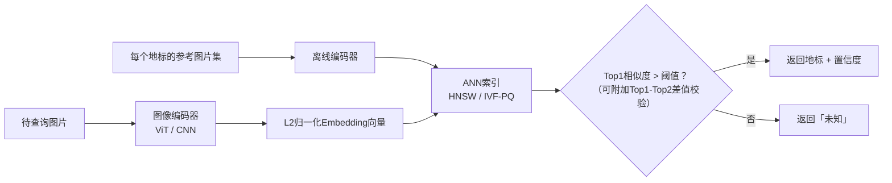

# 大规模地标/图像识别系统设计
一句话总结：把这个问题当成**开集Embedding检索**，而不是分类任务：基于度量学习损失训练图像编码器，将参考图片Embedding存入近似最近邻（ANN）索引；识别查询图片时，做近邻匹配，并使用校准后的相似度阈值，识别不出就返回「未知」，而不是强行猜测。在百万级、长尾、持续扩充的类别上直接用Softmax分类，是错误的思路。

---
## 解题思路
首先要跳出固有思维：“识别地标”听起来像是分类任务，但是地标库规模达到数百万、每天新增、极度长尾（埃菲尔铁塔有百万张样本，一个乡村教堂只有3张）；同时用户镜头可能拍到树木、路人、不在库内的地标。固定的Softmax分类无法适配这个场景。
所以先定义问题本质：**基于学习Embedding的检索 + 开集拒识（可以说不知道）**。
接下来明确规模和产品形态：地标总数、是端侧方案（Apple风格，隐私优先）还是服务端方案（Google Lens），“识别不出”是否是可接受结果（必须接受）。之后依次拆解：编码器&损失函数、索引、阈值、标注、评估。

## 高分回答
训练一个图像编码器（ViT或者高性能CNN骨干网络），将图片映射为归一化后的Embedding向量；使用**度量学习/对比损失**（ArcFace、三元组损失、SimCLR类目标函数）训练，保证同一个地标的不同图片向量靠近、不同地标向量远离。
为已知地标构建参考向量索引：每个地标存储多张标准参考图，覆盖不同角度、季节、昼夜场景。
查询阶段：把待识别图片编码成向量，使用近似最近邻检索（ANN，HNSW / IVF-PQ，FAISS、ScaNN框架）在索引中搜索；根据最优匹配相似度判断：相似度高于阈值，返回地标名称；低于阈值，返回**未知**。

检索方案优于分类的核心原因：新增地标只需要向索引插入向量，**不需要重新训练模型**；长尾地标只需要少量参考图，而分类方案每个类别都需要上千张训练图。

## 开集阈值（最容易被候选人忽略，决定产品可信度）
**宁可诚实说不知道，也不要给出自信但错误的答案**（对着商业街识别成泰姬陵会严重摧毁用户信任）。
在独立验证集上校准阈值，验证集必须包含负样本：非地标照片、故意不放进索引的地标照片，让模型学习到哪些样本属于“未知区域”。
除了Top1相似度，最好增加**Top1-Top2差值校验**：如果一张图片和10个地标相似度差不多，判定为模糊不确定，而不是强行给出结果。
阈值可以根据业务场景调整：旅游信息类功能容错更高，可以放宽；相册自动打标签功能，应该更保守，更容易返回未知。

## 标注与数据（最枯燥但最核心）
数据来源：
1. 人工整理的参考图集（维基共享资源、带地理标签的维基图片）
2. 用户照片GPS元数据（信号很强，但噪声很大：在斗兽场附近拍照，拍的不一定是斗兽场）
3. 头部热门地标人工核验标注

长尾是难点：绝大多数地标不可能人工标注。依靠GPS聚类图片+弱监督训练；接受长尾地标的精度会低于头部热门地标。
必须明确模型偏见：训练数据偏向西方、网红热门打卡点；在拍摄资料少的地区，模型效果系统性变差。评估召回率时，**必须按地区、地标热度分开统计，不能只看整体指标**。

## 方案对比：闭集分类器 vs Embedding+ANN检索
|对比维度|闭集分类器（N分类Softmax）|Embedding + ANN检索|
| ---- | ---- | ---- |
|新增地标|重新训练 / 新增分类头|直接向索引插入向量，无需重训|
|长尾场景（少量图片）|类别训练不充分，效果差|少量参考图即可工作|
|未知/非地标图片|强制输出一个类别，一定会乱猜|阈值控制，返回「未知」|
|扩展到百万级地标|输出层参数量爆炸|ANN检索是次线性复杂度，可支撑|

### 混合架构（端侧 + 服务端，量化计算）
- 服务端规模估算：1000万个地标 × 每个地标20张参考图 × 512维float16向量
$10M × 20 × 512 × 2字节 ≈ 205GB$ 原始向量，适合部署在服务端ANN集群，无法放到手机。
- 端侧规模估算：头部5万个热门地标 × 每个地标5张参考图 × 128维int8向量，总共32MB，比大部分相机App占用更小；绝大多数用户查询都是热门地标（查询分布和地标长尾分布一致）。

这个数字就是架构核心：手机本地快速处理32MB索引内的热门地标，隐私且低延迟；本地判定无法识别时，再发起网络请求，调用服务端205GB的全量索引处理长尾样本。

### 端侧 vs 服务端权衡（不是默认二选一）
- **端侧（苹果方案）**：延迟极低、图片不上传、保护隐私；缺点是手机存储有限，只能放压缩编码器+小索引，仅覆盖热门地标，长尾识别交给后端。
- **服务端（Google Lens）**：可以承载百万级全量索引、更大模型；缺点是需要网络往返、图片上传到服务器。

✅ 最优方案：**混合架构**
端侧放小型模型+头部地标索引，快速判断、低延迟，同时先做粗筛：判断这张图是不是地标；模糊样本、长尾样本再回传到服务端检索。
延迟指标：交互识别要求端到端 <300ms；端侧推理仅几十毫秒；服务端链路耗时主要是网络往返 + ANN检索（优秀索引下单次检索几ms~十几ms）。

## 评估方案
### 离线评估（检索指标）
在标注查询集上计算 Precision@1、Recall@k；**头部、长尾、不同区域分开报告**。
最重要的开集指标：负样本集上的误接受率（把非地标自信识别成某个地标的概率），和覆盖率（能成功识别的真实地标占比）做权衡。绘制「精度-覆盖率曲线」，基于曲线选定阈值。

### 线上A/B实验
观测点击通过率、用户修正率（手动修改/驳回识别结果）；设置硬性熔断规则：自信错误上报量上涨、长尾召回下降、延迟劣化，都要拦截上线。

### 数据反馈闭环
用户确认、修正的结果，变成新标注、新参考图，对长尾地标价值极高；用户点踩的样本，用来迭代下一轮模型训练。

## 面试官后续高频追问
1. **怎么实现“我不知道”？**
在包含非地标、隐藏地标样本的独立集校准相似度阈值；增加Top1-Top2差值校验识别模糊样本；根据业务对错误猜测的容忍度调整阈值。
2. **几百万类别，新增地标不能每次重训模型？**
这正是检索方案的优势：新增地标只需要插入索引；编码器学习通用视觉相似度，而不是固定类别列表。
3. **放端侧还是服务端？**
混合方案：热门头部地标放端侧，兼顾延迟隐私；长尾、模糊查询回传服务端。同时给出索引大小、网络往返耗时的量化依据。
4. **模型偏差在哪？**
偏向西方热门旅游地标；必须分地区、按热度统计召回，针对性补充长尾区域数据，整体指标会掩盖区域效果差距。

## 常见错误回答
- 直接定义为：训练CNN做N个地标的分类，不用检索。无法扩容、新增地标要重训、长尾效果差。
- 不处理开集识别：所有图片都强制输出一个地标，拍到无关物体也会自信认错。
- 只汇报整体准确率，掩盖长尾、部分地区极差的效果。
- 忽略端侧硬件限制，默认全部请求走服务端索引。
- GPS标签直接当成真值，忽略GPS噪声。
- 没有用户反馈闭环，浪费用户纠错这种低成本长尾标注数据。

## 核心要点总结
1. 问题本质：**开集Embedding检索，不是闭集分类**。度量学习编码器 + ANN索引；新增、长尾地标只需要插入索引、少量参考图，不需要重训。
2. 校准后的相似度阈值（搭配Top1/Top2差值校验）、支持返回未知，是产品可信度的核心；校准数据集必须包含负样本、预留未入库地标。
3. 慎重选择端侧/服务端，主流是混合架构：头部热门地标端侧识别，低延迟+隐私；长尾交给服务端。
4. 评估使用检索指标（Precision@1、Recall@k）+开集误接受率；指标拆分头部/长尾、分地区；把用户修正反馈回收作为长尾标注。

资深工程师的核心判断标准：意识到这是**开集检索而不是闭集分类**。地标库百万量级、持续新增、长尾分布，同时用户会拍到不在库内物体，不可能给每个地标分配Softmax类别。优秀候选人会使用Embedding模型+ANN索引+可返回未知的校准阈值。
面试官会深挖端侧vs服务端权衡（延迟、隐私 vs 索引容量）、长尾标注方案。
反面回答：只说“训练CNN分类N个地标”，没有检索、没有开集拒识逻辑，直接扣分。

决定可信度的细节，是「未知阈值」的校准方式，大部分候选人在校准集上出错：验证集里必须加入负样本、不在索引里的地标；否则阈值从来没见过它需要拒绝的样本。
Top1减去Top2差值校验是低成本优化，可以解决“图片和一堆地标相似度差不多，阈值却强行输出结果”的问题。

