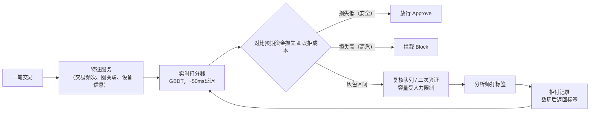

# 搭建支付欺诈检测模型
欺诈交易占比远低于1%；标签要等数周后，以拒付（chargeback）形式才会返回；欺诈分子会刻意针对你的模型进行对抗、调整作案方式。如果单纯优化准确率，最后得到的模型会直接放行所有交易。这个面试题的核心考点：**风险金额阈值判定、标签延迟问题、人员编制固定的人工复核队列**

> 一句话总结：不要优化准确率，也不要使用固定的概率截断值；基于**预期资金损失**设置阈值。当【欺诈概率 × 交易金额】大于**误拒绝一笔正常订单带来的损失**时，拦截这笔交易；灰色区间的交易送入人工复核队列，队列上限由实际可投入的人力决定。难点在于：样本极度不平衡、标签要滞后数周才随拒付返回、还有会持续适应模型的对手（欺诈者）

---
## 解题思路
先说明为什么准确率是陷阱：欺诈占比远低于1%，一个“全部放行”的模型准确率就能超过99%，但是抓不到任何欺诈。我们的目标是管控资金损失，而不是单纯提升分类正确率，因此目标函数要定义为**最小化预期损失**：
- 漏判（假阴性）损失：交易金额 + 拒付手续费
- 误拒（假阳性）损失：流失正常客户带来的收入损失，甚至永久流失客户

理清业务约束：支付链路里需要实时决策，延迟要求很严格；异步人工复核队列的人力是有限的；标签存在数周的滞后。这三个约束，再加上欺诈对手的对抗性，决定后续所有方案选择。

## 高分回答
整体架构分为两层：

实时打分模块嵌入在交易授权链路里，单次推理耗时控制在 50~100ms，所以选用轻量快速模型（梯度提升树、小型神经网络），输入预计算好的特征。模型输出不是简单“通过/拒绝”，而是按照**预期资金损失**划分成三类：直接放行、直接拦截、中间灰色地带。灰色地带会送入异步复核流程（比如二次身份验证3D Secure、交易挂起、人工分析师审核）。

区间划分阈值由业务成本决定：
> 当放行这笔交易带来的预期欺诈损失 ＞ 拒绝这笔交易带来的预期误拒成本，就拦截
> $\boldsymbol{p(欺诈) \times 交易金额 > (1-p(欺诈)) \times 误拒成本}$
> （只有当客户本身是正常用户时，拒绝这笔订单才会产生损失）

也就是说：一笔5000美元的交易，只需要很低的欺诈概率就会被拦截；而5美元的小额咖啡订单，需要极高欺诈概率才会拦截。

**同样的欺诈概率，对应的决策不一定相同，交易金额本身就是阈值的一部分**

### 举个例子理解阈值公式（方便面试口述）
假设误拒一笔正常订单，带来的综合损失（毛利损失+客服成本）是15美元。
拦截条件：$\boldsymbol{p \times 金额 > (1-p)\times15}$
变形得到：$\boldsymbol{p > \dfrac{15}{金额 +15}}$
- 5000美元转账：$p>15/5015≈0.3\%$ 就拦截
- 5美元咖啡订单：$p>15/20=75\%$ 才拦截

小额订单只有模型几乎判定是欺诈的时候才拦截，其余要么二次核验，要么直接放行。
同一个模型分数，比如欺诈概率1%：会拦截5000美元订单、放行5美元订单，两个决策都是合理的。
如果系统用统一固定概率截断，一定会踩坑：要么在高金额欺诈上持续亏钱（比如0.8%概率的大额订单直接放过），要么误拒大量小额正常买家（2%概率就拒绝咖啡订单，惹怒用户）。面试里讲这个例子，不用写公式，就能把**成本敏感**的核心思路讲清楚。

### 特征工程：欺诈模型胜负的关键
原始交易字段价值有限，最强信号是**交易频次特征、图网络关联特征**
1. 交易频次特征（Velocity）：这张卡/设备/IP，过去1分钟/1小时/1天的交易笔数；近一小时消费金额和账号历史基线对比；这个设备绑定过多少张不同银行卡
2. 图关联特征（Graph）：这个设备、邮箱、收货地址，有没有关联到其他发生拒付的账号？欺诈团伙会共用基础设施，一笔单独看没问题的交易，如果它的设备关联了12个拒付账号，风险极高
3. 其他信号：注册时长、输入/会话行为异常、设备指纹、银行卡BIN码和地理位置不匹配

这些特征必须保证线上实时计算、线下训练计算逻辑完全一致，由**特征仓库（feature store）统一维护**，不然会出现训练-服务偏移（train/serve skew），线上效果会莫名崩盘。

### 标签问题：这个是欺诈场景最微妙、最核心的难点
真实标签基本来自拒付，交易完成后2~12周才返回。
也就是说，任意时刻，最近几周的数据都是无标签/部分标签状态：新一轮欺诈攻击爆发了，在拒付回来之前，训练集完全看不到这批欺诈样本。
带来的问题：今天重新训练的模型，学习到的是1~2个月前的欺诈分布；拿近期数据算朴素指标会很好看，只是因为欺诈标签还没回来。

缓解方案：
- 显式管理标签成熟期：必须等拒付窗口期结束，才把这笔交易标记为“正常订单”
- 分析师复核结果、用户主动上报的欺诈作为快速、部分标签，提前响应攻击
- 监控先行指标：审批通过率、分数分布偏移，这些指标会比拒付更早暴露新攻击

|方案|优化目标|在欺诈场景下，失败/可行的原因|
| ---- | ---- | ---- |
|准确率、固定0.5阈值|分类正确率|全部放行就能拿到99%+准确率，毫无用处|
|最大化AUC / F1|排序效果、均衡错误|忽略一笔5000美元漏判和一笔5美元漏判的损失完全不一样|
|预期资金损失|欺诈损失 + 误拒损失之和|目标正确：和交易金额挂钩，对齐业务收益|
|带容量约束的阈值|损失最小，同时满足复核人力上限|贴合真实运营：灰色队列的工单量不能超过分析师处理上限|

### 样本不平衡 & 评估指标
不要追求准确率；正样本率大概0.5%，准确率没有意义。
优先用 **PR-AUC（精确率-召回率曲线，聚焦稀少的正样本欺诈）**，固定召回率看精确率、固定精确率看召回率；最终落地指标转化为：拦截欺诈总金额 VS 被误拒的正常订单金额。
训练处理不平衡：类别权重、Focal Loss；不要盲目过采样，人工合成欺诈样本容易脱离真实分布。

运营约束重点：复核队列容量固定。如果分析师每天最多处理5000条工单，灰色区间阈值就要控制每天产出约5000条工单。**操作点是由团队实际能承载的工单量对应的精确率决定，不是图表上F1最优的点**。

### 对抗性分布偏移（Adversarial drift）
这个问题和普通机器学习任务不一样，欺诈者会主动探测系统，找到可以通过的规则，集中从这个缺口作案；模型上线本身就会改变数据分布。
防御手段：
- 持续监控分数分布、特征偏移
- 在标签延迟的限制下高频重训模型
- 在模型上层保留规则层，分析师发现新型攻击模式后，可以快速上线规则，不用等模型迭代
- 冠军/挑战者（champion/challenger）灰度验证：新模型先在流量里对比验证，稳定后才接管决策

盲区陷阱：**被拦截的交易永远不会产生拒付**，模型永远不知道自己拒绝的订单其实是正常单。
解决方案：灰色流量里随机放行一小部分作为对照组，得到无偏的误拒率估计。

### 线上实验和熔断保护
做A/B实验（冠军挑战者对比），核心观测指标：拦截欺诈金额、正常订单误拒率、队列工单量和人力上限对比。
自动回滚熔断条件：
- 误拒率飙升（大量正常客户被拒，损失收入、损害信任）
- 复核队列工单严重超出处理能力
- 某个细分客群审批率断崖下跌

公平性也要监控：模型不能在地域、卡组织类型上出现差异化误拒，要分群体监控拒绝率。抓到更多欺诈不代表成功，如果代价是大量合法地区用户被误伤，方案是失败的。

---
## 面试官高频追问&回答
1. 面试官：模型准确率99.5%，是不是可以直接上线？
> 回答：不行。欺诈占比低于1%，全部放行就能达到这个准确率。要看PR-AUC，以及选定操作点下【拦截欺诈金额 VS 误拒损失】的权衡。

2. 面试官：拒付标签要好几周才回来，怎么处理？
> 回答：明确标签成熟周期；分析师确认的工单作为快速标签；监控审批率、分数分布这类先行指标，在拒付确认新一轮攻击之前提前预警。

3. 面试官：阈值怎么设置？
> 回答：在复核人力容量约束下，最小化预期资金损失；灰色工单总量不能超过分析师处理上限，所以阈值由可承载工单量对应的精确率决定，而不是F1最高点。

4. 面试官：欺诈分子会专门针对模型作案，怎么办？
> 回答：持续监控分布偏移、高频重训、规则层兜底新型攻击；上线前灰度对照；灰色流量随机放行对照组，用来发现误拒盲区。

## 常见错误
- 在0.5%欺诈占比场景下优化准确率、固定0.5概率截断，最后变成全部放行模型
- 5美元和5000美元交易用同一个概率阈值判断，没有结合交易金额计算损失
- 假设标签实时可用，拿还没走完拒付周期的近期数据，报虚高的好看指标
- 按照F1曲线选操作点，完全不考虑复核团队只能处理十分之一的工单
- 忽略对手是动态对抗的，模型静止不变，欺诈者绕开模型
- 忽略拦截交易带来的信息盲区：模型无法学到哪些拒绝是错误的

## 核心总结要点
1. 阈值基于**预期资金损失**：$p(欺诈)×金额$ 和误拒成本对比，而不是准确率、固定概率；交易金额本身是决策的一部分
2. 双层架构：50ms左右实时打分器，划分放行/拦截/灰色队列；异步复核队列，工单上限受人力约束
3. 交易频次特征、图关联特征效果远好于原始字段；用特征仓库统一供给，规避训练服务偏移
4. 提前设计方案应对标签延迟、对抗性分布偏移、拦截样本信息盲区；业务指标看资金损失、误拒损失，配套自动熔断机制

---

高级思路的核心是**成本敏感思考**：欺诈占比远低于1%，准确率没有参考意义（全放行就能99%+准确率）；优秀候选人会基于预期资金损失和误拒成本设置阈值，而不是固定概率截断。面试官会考察标签延迟（拒付滞后数周，模型用陈旧标签训练，新欺诈爆发很难及时发现）、对抗漂移（欺诈者探测、绕过模型）。错误回答套路：“训练XGBoost，优化AUC，0.5截断”。还要深挖复核人力约束：阈值本质由分析师每日可处理工单上限决定，不是F1最优值。

> @这个问题最容易拉开差距的盲区：被拦截的交易永远不会产生拒付，模型接收不到“这次拒绝是错的”这个信号；你算出来的精确率看起来很好，仅仅是因为指标只统计了你放行的订单。做法：在灰色区间里保留一小部分随机放行对照组，这是唯一能无偏估计误拒率的办法。
>
> 还要绑定复核队列的约束。灰色区间的宽度上限就是分析师人力。所以“优化阈值”实际含义是：**在团队今日可处理工单量下锁定精确率**。如果你的操作点产生的工单是队列承载上限的5倍，这不叫选阈值，这是在制造工单积压。

