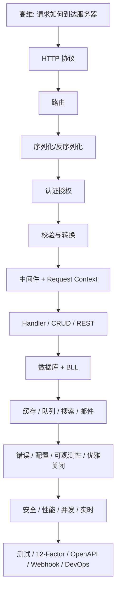

# 01 · 后端第一性原理路线图

一句话直觉：后端远不止 CRUD API，而是用「与语言无关的基础积木」搭出可靠、可扩展、容错且可维护的系统；本课给你一张完整地图，告诉你先学什么、后学什么、概念如何拼在一起。

## 本课要解决什么问题

- 后端范围极广，网上资源上千，**不知道学什么、怎么排优先级、何时把概念串成整体**。
- 很多人从大学/训练营/一门语言框架（Express、Spring Boot、Rails）入门，靠试错和他人帮忙摸索，**多年才搞懂原则**。
- 若只懂某一语言生态，换技术栈（如 Rails → Go）时**底层系统知识无法迁移**，产生盲区。
- 本课给出一门「从第一性原理出发」的视频路线图：先高维理解，再逐层深入协议、路由、序列化、鉴权……直到 DevOps。

## 核心概念详解

### 后端工程到底是什么

课程定义：后端工程是构建 **可靠（reliable）、可扩展（scalable）、容错（fault-tolerant）、可维护（maintainable）** 的代码库，以及**高效系统（efficient systems）**——远不止一堆 CRUD API。

### 为什么要从第一性原理学（两条核心痛点）

1. **资源多但缺大图**：不知道概念何时、如何拼在一起，学习周期被拉长到数年。
2. **从语言/框架视角入门**：用特定生态的透镜看问题，留下盲区；换语言时若不懂底层系统，可迁移知识很少。

应对：按**基础概念**组织内容（来自书籍、开源实践），不绑定某一框架。

### 路线图总览（课程将覆盖的主题）

下面按课程口述顺序整理；后续单课会逐一展开。

#### 1. 高维理解：请求如何到达后端

- 浏览器发出的请求如何经过网络、防火墙等跳点（hop），路由到远程（如 AWS）上的后端，再返回响应。
- 建立「客户端 ↔ 服务器」如何通信的生动图景。

#### 2. HTTP 协议（HTTP protocol）

- HTTP 的角色、原始报文长什么样。
- **Header 类型**：请求头（request headers）、表示头（representation headers）、通用头（general headers）、安全头（security headers）。
- **HTTP 方法**：GET / POST / PUT / DELETE 等——何时用、语义与原则。
- **CORS 流程**：简单请求 vs 预检请求（pre-flight）；浏览器 → 服务器 → 浏览器长什么样。
- **响应结构**与**状态码**：何时返回哪类码、常用码有哪些。
- **HTTP 缓存**：ETag、`max-age` 等。
- **HTTP/1.1 vs HTTP/2 vs HTTP/3** 差异。
- **内容协商（content negotiation）**、**持久连接（persistent connections）**。
- **压缩**：gzip / deflate / Brotli（BR）等及常用选择。
- **安全**：SSL / TLS / HTTPS。

#### 3. 路由（Routing）

- 如何把 URL 映射到服务端逻辑；路由与 HTTP 方法的关系。
- 组件：路径参数（path parameters）、查询参数（query parameters）。
- 路由类型：静态（static）、动态（dynamic）、嵌套（nested）、层级（hierarchical）、catch-all / 通配（wildcard）、正则（regex）路由。
- **API 版本化（versioning）**多种手法；如何优雅**弃用（deprecate）**；业界实践。
- **路由分组（route grouping）**：利于版本、权限、共享中间件。
- 保护路由、优化路由匹配性能。

#### 4. 序列化 / 反序列化（Serialization / Deserialization）

- 发送前把数据译成网络格式；收到后译回语言原生结构。
- 为何需要：互操作标准（interoperability）。
- 格式：文本（JSON / XML）vs 二进制（Protocol Buffers 等）；性能差异与选型。
- 各语言如何实现；深入 JSON：结构、类型（string / number / boolean / array / object）、嵌套与集合。
- 反序列化到 Python dict、Go struct、JS object 等。
- 常见错误：缺字段/多余字段、null、日期与时区。
- 自定义序列化；错误处理（非法数据、转换失败、未知字段）。
- 安全：注入类风险；**反序列化前校验**；JSON Schema。
- 性能：压缩、去掉无用字段；文本 vs 二进制的可读性/性能权衡。

#### 5. 认证与授权（Authentication / Authorization）

- 为何需要；有状态（stateful）vs 无状态（stateless）。
- Basic Auth、Bearer Token、Session、JWT、Cookie。
- OAuth、OpenID Connect；API Key；多因素认证（MFA）。
- 加盐（salting）、哈希（hashing）与密码学手段。
- 访问控制：ACL、RBAC、ReBAC 等。
- 安全实践：Cookie 安全、防 CSRF / XSS / MITM；审计日志（认证/授权事件、失败登录、提权、敏感资源访问）。
- 错误信息模糊化，防信息泄露；失败模式响应一致；限流与账号锁定。
- **防时序攻击（timing attacks）**：例如「用户名不存在」与「密码错误」耗时不同，可能被用来推断凭证是否有效。

#### 6. 校验与转换（Validation / Transformation）

- **语法校验（syntactic）**：邮箱、电话、日期格式是否合法。
- **语义校验（semantic）**：生日不能在未来；年龄在 1–120。
- **类型校验（type）**：是否为 string / int / array / object。
- 客户端校验 vs **服务端校验**：客户端改善 UX；服务端才是真正安全边界（进入业务逻辑的关口）。
- **Fail fast**：尽早返回，减少无用处理；前后端校验规则尽量一致。
- **转换（transformation）**：query/path 参数全是字符串，ID 需转成数字；日期格式对齐。
- **规范化（normalization）**：邮箱小写、去空白、电话加国家码。
- **消毒（sanitization）**：防 SQL 注入等。
- 复杂逻辑：字段关系（密码与确认密码一致）、条件校验（已婚才要求伴侣名）、链式校验。
- 错误：有意义的提示；一次聚合多个错误；敏感场景模糊措辞（如「凭证无效」而非「密码错误」）。
- 失败转换（非法 JSON、日期失败）要优雅处理；校验的性能权衡与早返回。

#### 7. 中间件（Middleware）

- 是什么、何时用、在请求周期中的角色（请求前 / 响应后）。
- **链式执行**：依次执行并 `next`，直到最终 Handler。
- **顺序至关重要**示例：打日志 → 认证 → 校验 → 路由处理 → 错误处理。
- 提前退出、短路（如 404）。
- 常见中间件：安全头（`X-Content-Type-Options`、HSTS、CSP）、CORS、防 CSRF、限流、认证复用、日志/可观测性、统一错误格式化、压缩、解析 JSON/表单/文件（含 multipart）。
- 保持轻量、正确顺序影响性能与安全。

#### 8. 请求上下文（Request Context）

- 请求作用域内的元数据，经中间件、controller、service 传递；**仅对该请求有效**。
- 生命周期：请求期间维护状态，跨层共享又不强耦合。
- 组件：HTTP method / URL / headers / query / body；会话与用户信息（常由认证中间件注入）；Trace / Request ID；请求期自定义数据（缓存结果、权限检查结果）。
- 用例：认证、限流、追踪、日志。
- 超时、取消信号；保持轻量、请求结束后清理防泄漏；避免过度用 context 传数据导致耦合。

#### 9. Handler / Controller / Service 与 CRUD

- MVC 视角下职责划分；用中间件减负。
- 集中错误处理；成功/错误响应格式一致。
- CRUD 与 HTTP 方法映射：POST 创建（常 201 / 400）；GET 列表或单资源；PUT/PATCH 更新；DELETE 删除。
- 分页、搜索、排序、过滤；严格校验、一致格式、限制载荷、脱敏、错误处理、鉴权。

#### 10. RESTful 架构与最佳实践

- 围绕资源设计；遵守 HTTP 语义。
- 过滤与分页实践。
- 版本化：URI / Header / Query / Media Type。
- 用 OpenAPI 思维设计；内容协商；有意义异常信息；ETag 等客户端缓存；大请求/响应优化。

#### 11. 数据库（Databases）

- 关系型 vs 非关系型；何时用哪种。
- 理论：ACID、CAP。
- 查询、连接（join）；Schema、索引；查询优化、缓存、连接池。
- 完整性：约束、事务、并发；ORM 取舍；迁移（migration）。

#### 12. 业务逻辑层（Business Logic Layer, BLL）

- 请求周期分层：校验/路由/中间件/handler 等偏**表现层（presentation）**；中间是**业务逻辑层**；再下是**数据访问层（DAL）**。
- 原则：关注点分离、单一职责、开闭、依赖倒置。
- 组件：Service、领域模型（User/Order）、业务规则与业务校验。
- 错误如何从 service 正确传播到表现层。

#### 13. 缓存（Caching）

- 为何需要；与 DB 持久化的区别。
- 类型：内存、浏览器、数据库缓存；客户端 vs 服务端。
- 策略：Cache-aside、Write-through、Write-behind/back、Read-through。
- 淘汰：LRU、LFU、TTL、FIFO；失效：手动、TTL、事件驱动。
- 层级：L1 内存、L2 分布式；层次化（热数据在小而快的 L1，冷数据在大而慢的 L2）。
- Web：静态资源与 API 响应头缓存；DB 侧查询结果进 Redis；优化 hit/miss 比率。

#### 14. 事务邮件（Transactional emails）

- 用例；结构：主题、预览文案（preheader）、页眉、正文、CTA、页脚；动态参数个性化。

#### 15. 任务队列与调度（Task queuing / Scheduling）

- 用例：发邮件、处理图片、第三方 API/支付/Webhook、重计算、批量清理（用户点「清除全部数据」应异步，不阻塞请求）。
- 调度：备份、周期通知、同步、清日志/缓存。
- 组件：Producer、Queue、Consumer、Broker、Backend；依赖链与父子任务；任务组并发等待；重试；优先级与限流（支付优先于通知）。

#### 16. Elasticsearch

- 为何用；倒排索引、TF-IDF、segment、shard。
- 用例：typeahead、日志分析、全文搜索。
- 建索引与查询；相关性；text vs keyword、analyzer、boost、分页。
- 高级：filter、aggregation、fuzzy；Kibana；映射显式定义、shard 数量、批量索引、避免滥用通配符。

#### 17. 错误处理（Error handling）

- 类型：语法、运行时、逻辑错误。
- 策略：fail-safe / fail-fast、优雅降级、预防。
- 实践：早捕获、不吞错误、自定义错误类型、优雅失败、打日志与堆栈。
- 全局错误处理；对用户友好且可行动的反馈；监控（Sentry、ELK）；邮件/Slack 告警。

#### 18. 配置管理（Config management）

- 灵活性：环境相关设置与应用逻辑解耦。
- 用例：多环境、安全管密钥/证书、功能开关。
- 类型：静态（DB 凭据、API 端点）、动态（feature flag、限流）、敏感配置。
- 来源：`.env` / JSON / YAML；环境变量 vs 命令行 flag vs 静态文件。

#### 19. 日志、监控与可观测性（Logging / Monitoring / Observability）

- 日志 vs 追踪 vs 监控 vs 可观测性。
- 日志类型：系统、应用、访问、安全；级别：debug / info / warn / error / fatal。
- 结构化 vs 非结构化；集中化、轮转与保留、有上下文、**禁止记密码/API Key**。
- 监控：基础设施、APM、可用性；Prometheus、Grafana；阈值与防告警疲劳。
- 可观测性三支柱：Logs、Metrics、Traces；合规与安全。

#### 20. 优雅关闭（Graceful shutdown）

- 场景：重启、云上缩容、微服务、长任务。
- 信号：SIGTERM / SIGINT / SIGHUP 等。
- 步骤：捕获信号 → 停止接新请求 → 完成进行中请求 → 关闭外部资源（DB、文件）→ 退出进程。

#### 21. 安全（Security）

- 攻击面：SQLi、NoSQLi、XSS、CSRF、破碎认证、不安全反序列化等。
- 设计原则：最小权限、纵深防御、安全失败默认、职责分离、Security by Design。
- 输入校验与消毒、限流、CSP、CORS、SameSite Cookie、事件监控。

#### 22. 扩展与性能（Scaling / Performance）

- 指标：响应时间、资源利用率、瓶颈识别。
- DB：避免 N+1、正确 join、适当懒加载、索引、批量处理。
- 防泄漏：关文件句柄/连接、长任务清理；减载荷与压缩。
- 测试与剖析；先清晰可维护，避免过早优化；模块化；负载下优雅降级；非关键任务进后台队列。

#### 23. 并发与并行（Concurrency / Parallelism）

- 并发利于 I/O 密集；并行利于 CPU 密集。

#### 24. 对象存储与大文件

- 如 S3；分块、流式；multipart 上传。

#### 25. 实时后端

- WebSocket、Server-Sent Events、Pub/Sub。

#### 26. 测试与代码质量

- 单元、集成、E2E、功能、回归、性能、负载/压力、UAT、安全测试。
- TDD；CI/CD 自动化；Lint/Format；圈复杂度、可维护性指数等。

#### 27. 十二要素应用（12-Factor App）

#### 28. OpenAPI 标准

- 为何遵守；文档、自动化、生态（Swagger、Codegen、Postman）；Swagger → OpenAPI 历史与版本。
- 文档结构：metadata、paths、parameters、schemas、components、security、responses。
- OpenAPI 3.0 / 3.1；避免重复、遵守标准。
- **API-First**：先写 Spec 再实现。

#### 29. Webhooks

- 用例：通知、第三方集成。
- API（客户端轮询）vs Webhook（服务端推送）。
- 组件：URL、事件触发、载荷、HTTP 方法、响应处理。
- 实践：签名校验、HTTPS、快速响应、重试、日志；用 ngrok 等测试；Stripe / GitHub / Slack / Discord 等。

#### 30. 后端工程师需要的 DevOps 概念

- CI / CD / Continuous Deployment。
- IaC、配置管理、版本控制。
- Docker、Kubernetes、CI/CD 流水线。
- 水平 vs 垂直扩展；蓝绿、滚动等部署策略。

### 学习路径心智图（概念如何串）

## 后端规则与最佳实践（Checklist）

- [ ] 把目标定为「可靠、可扩展、容错、可维护」，而不是「会写几个 CRUD」。
- [ ] 优先学**跨语言概念**，再选语言/框架实现，避免被单一生态绑架。
- [ ] 按路线图从 HTTP → 路由 → 数据进出 → 安全 → 分层 → 数据与缓存 → 运维，**有序深入**，不要东一榔头西一棒。
- [ ] 每个主题都问：它解决什么问题？在请求链路哪一跳？失败时如何表现？
- [ ] 换语言时迁移的是**问题与原则**（鉴权、校验、中间件顺序），不是某一库的 API 记忆。
- [ ] 安全相关（CORS、鉴权错误信息、时序攻击、反序列化前校验）从一开始就纳入心智模型。
- [ ] 中间件与分层顺序当作「规则」记忆：日志 → 认证 → 校验 → 业务 → 错误处理。

## 常见坑与反模式

- **只学框架教程**：会调 Express/Spring，不懂 HTTP/CORS/幂等，一出生产问题就盲。
- **用语言透镜看一切**：换栈等于从零开始。
- **资源堆砌无路线**：收藏上千链接却没有「概念地图」。
- **过早纠结网络底层细节**（后续课也会提醒）：应用层够用即可，别一上来掉进 TCP/TLS 无底洞。
- **把 CRUD 当后端全部**：忽略队列、缓存、可观测性、优雅关闭、安全纵深。

## 与前后课的关系

- **本课**：整条系列的地图与动机，不深入单点实现。
- **下一课（02）**：真正后端工程师的三阶段学习路径（故事/哲学 → 实现 → 生产项目）与期望管理。
- **再往后**：从「什么是后端」开始，按本课列出的顺序逐一展开（HTTP、路由、序列化……）。

## 参考来源

- 原课程字幕：`待整理的后端开发课程/1. 1. Roadmap for backend from first principles.md`
