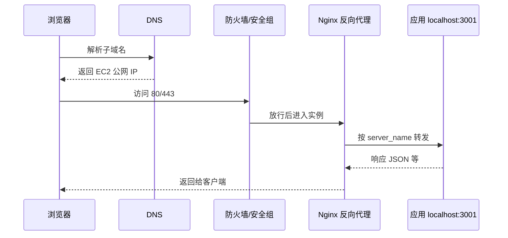

# 03 · 什么是后端、如何工作、为何需要

一句话直觉：后端是一台在开放端口上监听请求、为客户端服务数据/内容的服务器；请求会经过 DNS → 公网 IP → 防火墙 → 反向代理 → 应用进程；我们需要它，是因为**数据集中、持久化与动作编排**离不开一台「拥有全局状态」的机器——浏览器沙箱做不了真正的后端。

## 本课要解决什么问题

- 给出后端的**传统定义**，并补上「物理上请求怎么一跳跳走到应用」的全景。
- 用 Instagram「点赞 → 好友收到通知」说明后端存在的理由。
- 对比前端如何工作，回答：「为什么不把一切（含连库）都放前端？」——安全、CORS、数据库连接、算力四类硬限制。

## 核心概念详解

### 什么是后端（What is a backend）

传统定义：一台计算机，在某个**开放端口**上监听请求，例如：

- HTTP
- WebSocket
- gRPC
- 或其他协议

常见端口：`80`（HTTP）、`443`（HTTPS），可从互联网访问。客户端或其他前端连上它，按请求类型**发送或接收数据**。

称为 **server（服务器）** 的原因：它**提供/服务（serves）**内容，例如：

- 静态文件：图片、JS、HTML
- 动态数据：JSON 等
- 并接收客户端上传的数据

这是合理定义，但课程要求再看到**各组件在物理链路上如何协作**。

### 请求如何到达后端（How backends work）——完整跳点

演示场景：后端部署在 **AWS EC2**；浏览器访问某子域（如 `backend-demo...`），Network 面板可见请求/响应。

#### 跳点 1：域名与 DNS

- 浏览器先看到**域名 / 子域名**。
- DNS 用不同类型记录解析：
  - **A 记录**：指向某个 IP
  - **CNAME**：指向另一个域名/子域
- 示例：子域 `backend-demo` 的 A 记录指向某公网 IP——该 IP 来自 EC2 实例。

#### 跳点 2：到达云主机前的防火墙（Security Group）

- 流量到达 EC2 前经过 AWS 防火墙（安全组）。
- 安全组规定**哪些端口对公网开放**。
- 典型：SSH（运维登录）、**80 HTTP**、**443 HTTPS**。
- 若不放行 80/443，请求在防火墙被拦，**永远到不了应用**。

#### 跳点 3：反向代理（Reverse Proxy，如 Nginx）

- 反向代理：**坐在其他服务器前面**的服务器，集中管理重定向与配置，避免每台应用各自改配置。
- 常见配置点：
  - 监听 80，重定向到 443（HTTPS）；可用 **Certbot** 等自动证书（演示细节可后学）。
  - `server_name` 绑定子域；把该域流量**转发到本机应用端口**（如 Node 在 `localhost:3001`）。

#### 跳点 4：进程管理与真正的应用

- 用 **pm2** 等管理进程：同一实例上可同时跑前端进程与后端进程。
- 在实例内 `curl localhost:3001/users` 可得与公网相同的数据——说明对实例而言应用跑在本机，对外靠 Nginx + 域名暴露。

#### 链路总结

文字版：**浏览器 → DNS → AWS（经防火墙）→ EC2 → Nginx → localhost 应用端口**。

本地开发时直接 `localhost:3000/users` 看到的响应，与线上「打到本机端口」本质相同，只是少了公网与 DNS 那几跳。

### 为什么需要后端（Why do we need backends）

#### 点赞通知的例子

你在 Instagram 点赞 → 好友收到通知。中间发生了什么？

1. App 向服务器发请求。
2. 服务器解析：谁点的赞（用户 ID）。
3. **持久化**点赞动作（通常写入数据库）。
4. 查出帖子作者，触发通知。
5. 好友设备收到通知。

关键点：你的 App 只关心「你的画像与你的关注」；好友设备只收「给他的通知」。但必须有一台**中心化机器**掌握**所有用户的状态与数据**，才能编排这些动作。

#### 浓缩成一个词：数据（Data）

后端职责可压成：

- 拉取数据（fetch）
- 接收数据（receive）
- 持久化数据（persist）
- 以及一切与数据相关的动作

### 前端如何工作（对照）

同一 EC2 上的 Next.js 前端演示：

1. 浏览器先拉 **HTML 文档**。
2. 再分别请求 JS、CSS、字体、图片等。
3. DNS / 防火墙 / Nginx 类似，但转发到另一端口（如 `3000`）。
4. 拿到 HTML 后：CSS 用于绘制样式；JS 用于**水合（hydrate）**事件监听——按钮点击等交互才生效。

### 为何不能把后端逻辑写在前端

| 维度 | 后端（服务器运行时） | 前端（浏览器运行时） |
|------|----------------------|----------------------|
| 代码在哪执行 | 请求到服务器，**在服务器上处理**再返回结果 | 服务器把代码发给你，**在你机器的浏览器里执行** |
| 环境 | 可访问文件系统、环境变量、原生驱动等 | **沙箱（sandbox）**：与 OS/进程/文件系统隔离 |

浏览器只能有限访问：DOM、部分 Browser API（localStorage、Cookie）、以及符合策略的外部 API。

#### 原因 1：安全（Security）

- 浏览器故意限制极严。
- 后端常需写日志、读环境变量、访问文件系统——浏览器不允许。
- 浏览器从远程拉代码并在用户机器执行；若不隔离，恶意页可读本地文件并外传——故有沙箱与策略。

#### 原因 2：调用外部 API 受限（CORS 预告）

- **CORS（Cross-Origin Resource Sharing）**：浏览器安全策略，限制页面 JS 随意调用「与当前页不同源」的 API。
- 同源才默认允许；跨域需服务端正确 HTTP 头（后续 HTTP 课详解）。
- 后端经常要连很多第三方服务；浏览器侧「处处要 CORS」是硬伤，且你控制不了所有外部 API。

#### 原因 3：数据库（Databases）

- 服务端有原生驱动（如 Postgres 的 `pg`、MongoDB 驱动），能高效处理套接字、二进制、**持久连接**。
- 后端用**连接池（connection pool）**：复用连接，避免每个请求建连/断连；否则高 QPS 会压垮数据库。
- 浏览器不适合维护到 DB 的持久连接；即便能，**每个用户各开连接**也会打爆 DB，且难做连接池与高效查询。

#### 原因 4：算力（Computing power）

- 前端设备五花八门：手机、老电脑、甚至极少内存单核设备。
- 重业务逻辑放客户端易卡顿、崩溃。
- 中心化后端可按需加 CPU/内存，统一扛负载。

结论：把后端逻辑塞进前端——即便技术上勉强可行——通常也是坏主意。

## 后端规则与最佳实践（Checklist）

- [ ] 记住请求链路：DNS → IP → 防火墙端口 → 反向代理 → 应用进程。
- [ ] 生产环境务必正确开放 **80/443**（及运维所需端口），并理解安全组是第一道门。
- [ ] 用反向代理终结 TLS、按域名转发，而不是把每个 Node/Go 进程直接裸暴露公网（常见实践）。
- [ ] 后端存在的核心理由是**中心化的数据与状态**，不是「多一个写 JSON 的地方」。
- [ ] 永远不要假设「前端也能连库所以不需要后端」——安全、连接池、CORS、算力都会打脸。
- [ ] 本地 `localhost` 调试与线上「打到本机端口」同构；差别在公网跳点。

## 常见坑与反模式

- **只知「后端 = 写 API」**：不知 DNS/防火墙/反向代理，排障时只会怪应用代码。
- **安全组未放行 80/443**：应用「明明在跑」但外网全挂。
- **把业务机密与 DB 凭证塞进前端包**：等同公开给所有访客。
- **每个浏览器直连数据库**：连接数与安全双爆。
- **忽略同源/CORS**：前后端分端口/分域部署时「本地能调、浏览器报错」却怪框架。

## 与前后课的关系

- **上一课（02）**：学习路径与期望；本课开始真正建立「后端是什么」的体感。
- **下一课（04）**：为何用第一性原理学后端——对修 bug、跨语言、选工具、就业的具体收益。
- **更后（05 HTTP）**：深入 CORS 头、报文、状态码等——本课只预告 CORS。

## 参考来源

- 原课程字幕：`待整理的后端开发课程/3.   Skip navigation Sriniously     Create   Avatar image 3. What is a Backend, how do they work and why do we need them?.md`
