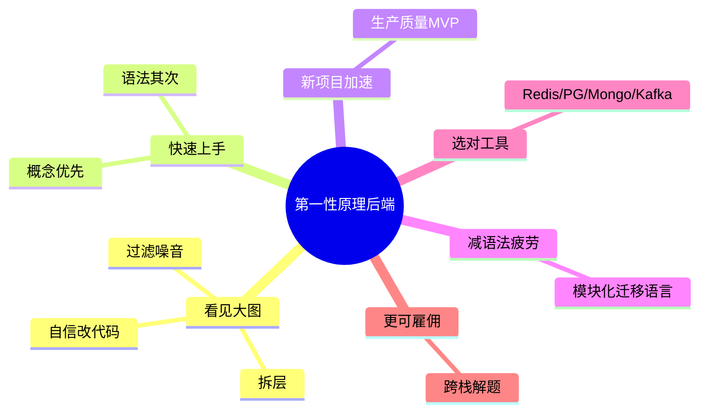

# 04 · 第一性原理学习后端的收益

一句话直觉：把后端拆成普适积木（路由、中间件、鉴权、DB……）后，你进陌生仓库不迷路、换语言不从零、开新项目不靠抄教程、选技术不被「我是某某语言工程师」标签困住——最终从「框架开发者」升级为真正的软件工程师。

## 本课要解决什么问题

- 用具体职场场景说明：为何「从第一性原理学后端」值钱。
- 澄清「第一性原理」在本系列的含义：**不是教条规则列表**，而是代码库无论大小都围绕其运转的**基础积木 / 领域地图**。
- 激励刻意练习：不必等十年经验才学会「看仓库抓模式」。

## 核心概念详解

### 触发场景（你可能正在经历的痛）

1. **修后端 bug**：你是前端，被丢进不熟语言的后端仓——从哪看起？如何不淹没在复杂度里？
2. **从零写 API**：如何形成代码库心智地图、守标准、不破坏现有行为？
3. **跨语言跳槽式任务**：你熟 TypeScript/Go，突然要上 Rust/Python——如何快速上手，而不是泡在 FastAPI / Pydantic / Axum / SQLAlchemy / Diesel 文档里空转？
4. **核心问题**：如何在新环境**复用已有知识**，而不是每次重新发明轮子？

答案：从第一性原理学——把复杂系统拆成**最基本、普适的组件**。

### 收益一：看见大图（Seeing the big picture）

进入现有代码库时：

- 不被目录结构或「过度工程」吓到。
- 能在脑中拆分：核心业务逻辑、路由层、数据库连接、以及噪音部分。
- 过滤噪音后，有信心改代码、修 bug。

高级工程师 / CTO 扫一眼就能大致知道「发生了什么、bug 可能在哪」——人脑擅长抓**模式（patterns）**。他们多半是潜意识在用模式；你不必等数年，可从第一天**刻意练习**，在约 6–12 个月内变强。

### 收益二：更快上手（Faster onboarding）

一旦理解：

- HTTP 如何工作
- 数据库如何与 API 交互
- 请求如何流经中间件

则换任意语言/框架都能找路：

- 不必先啃数小时库文档。
- 鉴权 / 路由 / 中间件 / DB 交互的**概念**已会，**语法是次要的**。
- 穿透噪音，盯逻辑而非语法糖 → 更快建立对代码库的熟悉感。

### 收益三：新项目上 10x 更快（10x faster on new projects）

从零开始时：

- 靠对系统需求的深刻理解推进，而不是跟着 boilerplate 教程。
- 能更快做出**带生产质量**的 MVP：路由结构、DB 连接、缓存、错误处理、日志等「关键能力」不用反复翻文档才敢写。

### 收益四：减轻「语法疲劳」（Syntax fatigue）

学新语言已经够累；若：

- 语法会了却不知下一步学什么概念，或
- 不知如何把语法用到真实后端问题上  

→ 易挫败甚至 burnout。

第一性原理降低语法疲劳：积木清晰后，换语言只是「同一问题换语法与库」。  

**跨语言实操模板（以 Node → Rust 为例）**：

1. 已理解各层：路由 → 中间件 → DB → 日志 → 错误处理 → 异步等。
2. 掌握 Rust 基础语法与社区推荐项目布局。
3. **逐模块攻坚**：对每个模块（校验、鉴权、REST、repository……）你已知道「生产级长什么样」。
4. 去查「Rust 里校验怎么做」→ 找到库或标准库模式 → **把已知最佳实践套进新语法**。
5. 模块叠模块，数天内可拼出生产级骨架——而不是苦等「完美的 4–5 小时 Rust 全栈教程」（新语言往往缺这种资源）。

### 收益五：选对工具做对事（Right tool for the right job）

常见困境：标签化自己——「我是 Node 后端」/「我是 Ruby 后端」——遇到高并发或超低延迟需求时，仍死磕惯用语言，不敢换更合适的工具。

理解后端真正在解决的问题（持久化、请求处理、安全、扩展等）之后：

- 不再被单一框架/语言限制。
- 知道何时用 Redis 缓存、Postgres 关系数据、Mongo 非结构化、Kafka 实时事件流——**与当前技术栈标签无关**。

### 收益六：更好就业（More employable）

雇主要的是：能批判性、独立思考，加入任意团队就能快速贡献价值的人。

掌握原则 → 成为**不被特定语言/栈囚禁**、能在任何环境解题的适应型工程师 → 更值钱。

好消息：不必等「多年经验」；今天就可以聚焦跨系统不变的核心（路由、数据库、鉴权等），建立导航新领域的**内在罗盘**。目标不只是问题出现时能解决，而是**有信心且高效**地解决；久而久之形成接近本能的直觉。

### 「第一性原理」在本系列的定义

不是一份死板 Rules 清单，而是：

- 代码库无论大小，**始终围绕其运转**的基础积木 / 基础组件；
- 一张后端工程疆域的**通用地图**，帮你找路。

下一课起开始真正「逛地图」。

## 后端规则与最佳实践（Checklist）

- [ ] 进陌生仓库先画层：路由 / 中间件 / 业务 / 数据访问 / 基础设施噪音。
- [ ] 学新语言时：**概念清单 × 语法**，按模块移植生产模式，而不是搜「完整项目教程」卡住。
- [ ] 选型时问问题域（延迟、一致性、数据形态、吞吐），再问语言标签。
- [ ] 刻意练习「模式识别」：每次读开源或同事代码，标注对应积木。
- [ ] 把原则课当作地图；实现课当作坐标上的建筑施工。

## 常见坑与反模式

- **身份绑死在技术栈**：拒绝更合适的工具，用熟悉的锤子敲所有钉子。
- **文档驱动学习而无问题清单**：在库 API 里迷路，却仍不会鉴权/校验/分层。
- **等完美教程才动手**：新生态资源少时尤其致命；原则 + 模块拼装才可迁移。
- **只背规则条文**：忘了原则是「地图与积木」，要能在真实仓里定位与组合。

## 与前后课的关系

- **上一课（03）**：后端是什么、请求链路、为何需要后端。
- **本课（04）**：为何用第一性原理学——收益与学习姿态。
- **下一课（05）**：地图上的第一大站——**HTTP 协议**（无状态、报文、方法、CORS、状态码、缓存等）。

## 参考来源

- 原课程字幕：`待整理的后端开发课程/4.benift.md`
