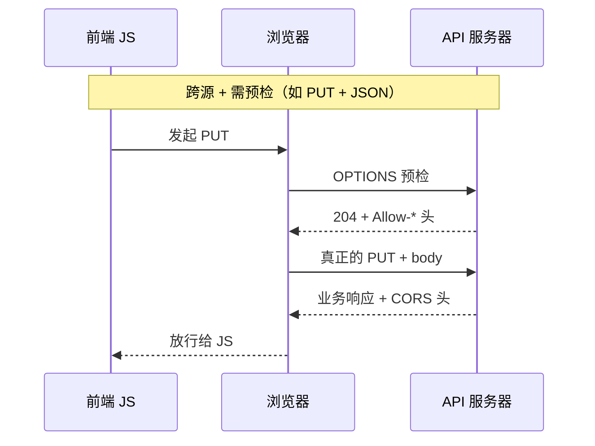

# 05 · HTTP 协议详解

一句话直觉：HTTP 是浏览器与服务器交换数据时最常用的「应用层语言」——无状态、客户端发起；用方法表达意图、用头做元数据遥控、用状态码标准化结果、用 CORS/缓存/协商/压缩扩展能力；HTTPS 只是套上 TLS 加密的同一套语义。

## 本课要解决什么问题

- 后端话题太多，本课只抓**约 90% 代码库都会用到的 HTTP**。
- 讲清：无状态与客户端-服务器模型、报文结构、头为何存在与如何分类、方法语义与幂等、CORS 简单/预检流程、状态码、缓存头、内容协商与压缩、持久连接、大文件（multipart / chunked）、SSL/TLS/HTTPS 到什么深度够用。
- 原则：**先懂机制（what），再谈某语言怎么写（how）**；演示可用任意语言的服务器 + 抓包工具（如 Burp Suite）。

## 核心概念详解

### HTTP 是什么、为何聚焦它

HTTP 是浏览器与服务器**发送/接收数据**的主要媒介。还有其他协议，但 HTTP 使用最广，故优先掌握。

### 两大核心思想

#### 1. 无状态（Statelessness）

- 服务器**不记住**过去的交互。
- 每个请求必须自带处理所需的一切（头、URL、方法、鉴权信息等）。
- 响应结束后，服务器忘掉该请求；下一次当作全新、无关事件。

**好处**：

- **简单**：服务器不必存会话，少资源与复杂度。
- **易扩展**：请求可分到多台机器，无需「某台记住会话」。
- **崩溃友好**：无会话状态需恢复。

**现实**：业务常需要连续性（登录、购物车），故在无状态之上叠加 Cookie / Session / Token 等——后续鉴权课展开。

#### 2. 客户端-服务器模型（Client-Server）

- **客户端**（浏览器或 App）**发起**请求，提供 URL、头等。
- **服务器**托管资源（网站、API 等），等待请求，处理后返回页面、数据、错误或各类内容。
- HTTP：**通信总是由客户端发起**以获得服务器响应。

本系列可认为 **HTTP 与 HTTPS 可互换理解**：HTTPS 是更安全的 HTTP，原则相同，多了加密与证书（TLS 等），偏网络工程；应用层语义一致。

### 传输层简述（够用即可）

- 收发前需建立连接；HTTP 依赖可靠传输，互联网上常用 **TCP**（相对 UDP 更可靠）。
- HTTP **不强制**底层必须是面向连接的，但要求可靠、尽量不丢消息。
- OSI 模型中，后端日常多在**第 7 层应用层**；TCP 握手、TLS 细节可知即可，避免掉进网络无底洞。
- 记住：**客户端与服务器建立网络连接后收发消息**——对本课足够。

### HTTP 版本演进（Evolution）

| 版本 | 要点 |
|------|------|
| HTTP/1.0 | 每请求新连接；建连/关连开销大 |
| HTTP/1.1 | **持久连接（persistent connections）**；同 TCP 上多请求；分块传输、更好缓存 |
| HTTP/2 | **多路复用（multiplexing）**；二进制分帧；HPACK 头压缩；**Server Push** |
| HTTP/3 | 基于 **QUIC**（跑在 UDP 上）；更快建连、降延迟、更好处理丢包；多路复用且改善 HTTP/2 的队头阻塞 |

日常记：连接建立后收发消息；版本在性能与传输细节上进化。

### HTTP 报文（Messages）

- **请求报文**：客户端发出。
- **响应报文**：服务器返回。

**请求大致结构**：

1. 方法（method）
2. 资源 URL（path）
3. HTTP 版本（如 1.1，仍很常用）
4. 头字段（如 Host）
5. 空行（表示头结束）
6. 可选 **body**（要发给服务器的数据）

**响应大致结构**：

1. HTTP 版本
2. **状态码** + 原因短语（如 `200 OK`）
3. 响应头
4. 空行
5. 可选响应 body

### 为何需要 Header（快递类比）

头是**键值对元数据**。为何不塞进 URL 或 body？

类比寄包裹：收件人地址、电话写在**外面**，而不是封在箱子里——承运方沿途要读元数据，不应反复拆箱。HTTP 头同理，且用途更广。

#### Header 分类

**1. 请求头（Request headers）**——客户端 → 服务器，描述请求本身/客户端能力：

- `User-Agent`：浏览器 / Postman / App 等
- `Authorization`：如 Bearer Token
- `Accept`：期望的内容类型（JSON / text / HTML…）

帮服务器理解环境、偏好与能力。

**2. 通用头（General headers）**——请求与响应都可用，描述报文本身：

- `Date`
- 缓存相关：`Cache-Control: no-cache` / `max-age` 等
- `Connection: keep-alive` / `close`

**3. 表示头（Representation headers）**——描述 body 的表示：

- `Content-Type`：媒体类型（JSON / HTML…）
- `Content-Length`：字节大小
- `Content-Encoding`：gzip / deflate 等
- `ETag`：资源唯一标识，多用于缓存

**4. 安全头（Security headers）**——约束浏览器行为、加强安全：

- **HSTS（Strict-Transport-Security）**：只走 HTTPS，防协议降级
- **CSP（Content-Security-Policy）**：限制脚本来源，缓解 XSS
- **X-Frame-Options**：防被 iframe 嵌入（点击劫持）
- **X-Content-Type-Options**：禁止 MIME 嗅探
- Cookie 的 **HttpOnly / Secure** 等

#### Header 的两个思想

1. **可扩展性（Extensibility）**：加自定义头即可改变行为，不必改协议本身（安全增强、`X-Custom-*`、内容协商等）。
2. **遥控（Remote control）**：客户端用头表达偏好/指令，影响服务器如何处理：
   - `Accept` 协商格式
   - `Cache-Control` / `Expires` 控制缓存
   - `Authorization` 影响访问控制

### HTTP 方法（Methods）——表达意图（Intent）

方法定义客户端想对服务器资源做什么，赋予**清晰语义**：

| 方法 | 意图 | 要点 |
|------|------|------|
| GET | 获取数据 | **不应**修改服务器状态 |
| POST | 创建/提交 | 通常有 body |
| PATCH | 部分更新 | 选择性修改；常有 body |
| PUT | 完整替换 | body 应**整体替换**原资源 |
| DELETE | 删除资源 | 按名知义 |
| OPTIONS | 询问能力 | 常用于 CORS 预检（开发者很少直接发） |

经验法则：除非有明确「整资源替换」需求，**优先 PATCH 而不是滥用 PUT**（业界常误用 PUT）。

### 幂等 vs 非幂等（Idempotent vs Non-idempotent）

- **幂等**：同一请求调用多次，效果/结果可视为相同。
  - 通常：**GET、PUT、DELETE** 视为幂等  
    - GET：多取几次不应改数据  
    - PUT：用同一新内容反复整换，最终状态相同  
    - DELETE：删一次后资源已不在，再删结果仍是「不存在」
- **非幂等**：通常 **POST**——每次创建可产生新资源（如连续建两条笔记），结果不同。

### OPTIONS 与 CORS 工作流

回顾：**同源策略（Same-Origin Policy）**——默认限制网页向**不同源**发请求。  
**CORS** 是浏览器强制的机制，让服务器声明「谁可以跨域访问、如何访问」。无 CORS 放行时，浏览器会拦截跨域响应。

源不同示例：`example.com` 的前端调 `api.another-example.com`。

跨域主要有两类流：

#### A. 简单请求（Simple request）

典型：方法为 **GET / POST / HEAD**，且头与 Content-Type 足够「简单」。

流程概要：

1. 浏览器自动加 `Origin` 头。
2. 服务器按 CORS 策略检查 `Origin`。
3. 若允许，响应带 `Access-Control-Allow-Origin`（具体源或 `*`）。
4. 浏览器核对：若源匹配或 `*`，把响应交给前端 JS；否则**拦截**并报 CORS 错误（即使服务器其实已处理请求——常见坑）。

#### B. 预检请求（Preflight）

浏览器先发 **OPTIONS** 询问能力，再发真实请求。

触发预检的条件（在已是跨源前提下，满足**任一**即可）：

1. 方法不是 GET/POST/HEAD（如 PUT、DELETE）
2. 带有「非简单」头（如 `Authorization`、自定义头）
3. `Content-Type` 不是简单类型（`application/x-www-form-urlencoded`、`multipart/form-data`、`text/plain` 之外）——**`application/json` 会触发预检**

因此前后端日常大量 JSON API → **多数请求会预检**。

预检 OPTIONS 典型内容：

- `Origin`
- `Access-Control-Request-Method`：真实方法是否被允许
- `Access-Control-Request-Headers`：需要的头是否被允许
- **无业务 body**

服务器成功响应常为 **204 No Content**，并带：

- `Access-Control-Allow-Origin`
- `Access-Control-Allow-Methods`
- `Access-Control-Allow-Headers`
- `Access-Control-Max-Age`：预检结果可缓存多久（减少重复 OPTIONS）

浏览器勾选通过后，再发原始请求。

**同源细节**：即便同主机，**不同端口**（如 `localhost:5173` vs `localhost:3000`）也被浏览器视为不同源。

演示工具：Burp Suite 等拦截 HTTP，观察简单请求去掉 `Access-Control-Allow-Origin` 后被拦、以及 OPTIONS → PUT 的完整预检链。

### 响应状态码（Status codes）

**为何需要**：标准化表达结果，客户端不必靠「猜 body 形状」判断成败；跨语言服务一致约定。

三位数，按首位分类：

| 类 | 含义 |
|----|------|
| 1xx | 信息性（Informational） |
| 2xx | 成功 |
| 3xx | 重定向 |
| 4xx | 客户端错误 |
| 5xx | 服务器错误 |

#### 1xx（了解即可）

- **100 Continue**：大上传时可先发头，服务器同意后再发 body。
- **101 Switching Protocols**：如升级到 WebSocket。

#### 2xx（常用）

- **200 OK**：成功，返回资源或完成动作（典型成功 GET）。
- **201 Created**：已创建新资源（典型成功 POST）。
- **204 No Content**：成功但无 body（预检 OPTIONS；有时 DELETE）。

#### 3xx（常用）

- **301 Moved Permanently**：永久迁到新 URL；客户端以后应用新地址（如 `/user` → `/person` 保兼容）。
- **302 Found（临时重定向）**：暂时去别处，**以后仍用原 URL**（如短期活动页）。
- **304 Not Modified**：资源未改，用缓存（配合条件 GET / ETag）。

#### 4xx（后端日常最多）

- **400 Bad Request**：数据非法/格式不对（要数字给了字符串等）——让客户端改请求。
- **401 Unauthorized**：需要认证但未提供或凭证无效/过期（如缺 JWT）——常触发重新登录。
- **403 Forbidden**：已理解请求但拒绝授权——**即使已登录**也可能（如 A 删 B 的资源）。
- **404 Not Found**：URL 错或资源已删——最知名。
- **405 Method Not Allowed**：该资源不接受此方法（前端方法写错常见）。
- **409 Conflict**：冲突（如文件夹名唯一约束）。
- **429 Too Many Requests**：限流（如每秒最多 60 次）。

#### 5xx

- **500 Internal Server Error**：未预期异常；**勿把内部细节泄露给客户端**。
- **501 Not Implemented**：暂不支持该功能/方法，可能未来支持。
- **502 Bad Gateway**：作为代理/负载均衡时，上游返回无效响应（多由 Nginx 等产生）。
- **503 Service Unavailable**：过载或维护，请稍后重试。
- **504 Gateway Timeout**：上游在超时内未响应。

掌握上述即可覆盖约 95% 场景。

### HTTP 缓存（Caching）

目的：复用未变更的响应副本 → 加快加载、省带宽、减服务器负载。

关键响应头示例：

- `Cache-Control: max-age=10`：最多缓存 10 秒
- `ETag`：资源指纹（常为内容哈希）
- `Last-Modified`：最后修改时间

再请求时，客户端可带条件头：

- `If-None-Match`：对照 ETag
- `If-Modified-Since`：对照修改时间  

语义：若 ETag 仍匹配且未在此时间后修改 → 服务器回 **304**，客户端用本地缓存；若已变 → **200** + 新 body + 新 ETag。

生产注意：服务端必须正确维护 ETag；忘记更新会导致客户端一直用脏缓存。现代前端也常用 **React Query** 等客户端缓存策略，在许多场景更可控；HTTP 缓存对简单场景仍有价值。

### 内容协商（Content negotiation）

客户端与服务器就「最佳表示」达成一致。

三类常见：

1. **媒体类型**：`Accept: application/json` / XML / HTML…
2. **语言**：`Accept-Language: en` / `es`…
3. **编码（压缩）**：`Accept-Encoding: gzip, deflate, br, zstd`…

服务器按偏好返回对应格式/语言；无完美匹配时可回退。

### HTTP 压缩（Compression）

大 JSON 等可在服务端 gzip 等压缩，响应带 `Content-Encoding: gzip`；浏览器自动解压。

演示量级：同约 1.1 万条数据，压缩后约数 MB，关闭压缩可暴涨到数十 MB——带宽与体验差异巨大。常用 gzip；另有 deflate、Brotli（BR）等。

### 持久连接与 Keep-Alive

- HTTP/1.0：默认每请求一连接，TCP 建连贵。
- HTTP/1.1：**默认持久连接**，同连接多请求。
- `Connection: keep-alive` 可显式保持；可带 timeout / max。
- `Connection: close`：响应后关闭（1.0 默认行为，1.1 仍可强制）。

多数情况默认即可，应用开发较少手改。

### 大请求 / 大响应

#### Multipart（上传大文件）

- `Content-Type: multipart/form-data; boundary=...`
- 二进制分部分传输；**boundary** 作各 part 分隔符。
- 适合图片/音视频等相对 JSON 很大的载荷。

#### 分块 / 流式下发

- 如 `Content-Type: text/event-stream` + `Connection: keep-alive`
- 服务器持续推 chunk，客户端拼接；适合大文本流式下载。

### SSL、TLS 与 HTTPS（应用层够用深度）

- **SSL**：早期加密协议，已过时且有漏洞。
- **TLS**：现代替代，加密传输中的数据，用证书认证服务器，防窃听与篡改；推荐较新版本（如 TLS 1.3 一代）。
- **HTTPS**：HTTP + TLS（历史上也曾说 SSL）提供的安全能力。

后端应用层开发：理解「敏感数据走 HTTPS/TLS」即可，细节属网络域。

## 后端规则与最佳实践（Checklist）

- [ ] 每个请求自包含；需要「登录态」时用 Cookie/Session/Token，别幻想裸 HTTP 记住用户。
- [ ] 方法遵守语义：GET 只读；创建用 POST+201；部分更新优先 PATCH；整换才 PUT。
- [ ] 幂等：对可安全重试的操作优先设计为幂等（尤其写操作与支付相关要额外谨慎）。
- [ ] 跨域 API 正确返回 CORS 头；JSON/带 Authorization/PUT/DELETE 预估会有 OPTIONS。
- [ ] 用对状态码：400 校验失败、401 未认证、403 无权限、404 不存在、409 冲突、429 限流、5xx 少泄密。
- [ ] 缓存：设好 `Cache-Control` / ETag；变更资源时更新 ETag。
- [ ] 大响应开压缩；大上传用 multipart；必要时流式下发。
- [ ] 生产对外 API 走 HTTPS。

## 常见坑与反模式

- **用 PUT 做部分更新**、用 GET 做删除/修改——破坏语义与缓存/中间件假设。
- **CORS：服务器「其实 200 了」但浏览器仍报错**——缺 `Access-Control-Allow-Origin` 等，问题在浏览器策略不是「API 没跑」。
- **预检失败却只查业务路由**：OPTIONS 未实现或 Allow-Headers 漏了 `Authorization`/`Content-Type`。
- **401/403 混淆**：没登录 vs 没权限。
- **500 把堆栈返回给前端**：信息泄露。
- **ETag 忘更新**：客户端长期脏读。
- **本机不同端口当同源**：前后端分离开发必踩 CORS。

## 与前后课的关系

- **上一课（04）**：为何学第一性原理；本课是地图上第一块硬核协议。
- **下一课（06）**：路由——方法是「做什么（what）」，路由是「对哪里做（where）」。
- **更后**：序列化、鉴权等会建立在 HTTP 报文、头与状态码之上。

## 参考来源

- 原课程字幕：`待整理的后端开发课程/5.http.md`
