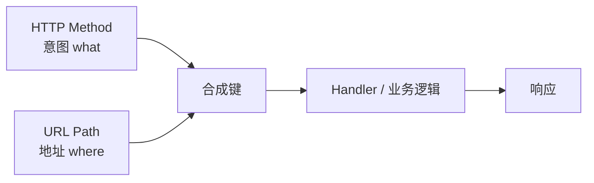

# 06 · 路由（Routing）

一句话直觉：HTTP 方法回答「要对资源做什么（what / intent）」，路由回答「对哪里做（where）」——二者组合成键，映射到服务端 Handler；路径参数、查询参数、嵌套、版本化与 catch-all 都是把「地址」说清楚的手法。

## 本课要解决什么问题

- 在已理解 HTTP 方法语义的前提下，讲清**路由如何把 URL 映射到服务端逻辑**。
- 覆盖：静态/动态路由、path vs query 参数、嵌套路由、版本化与弃用、catch-all。
- 建立读任意后端仓时定位「路由层」的能力（不依赖具体语言；`:id` 等是业界惯例）。

## 核心概念详解

### 方法是 what，路由是 where

- **方法（GET/POST/…）**：意图——取、增、改、删。
- **路由（URL path）**：地址——对哪个资源动手。

例：`GET /users` → 「获取」+「用户集合」→ 服务器返回用户数组。

服务器把 **方法 + 路径** 映到某个 Handler（及其中业务逻辑、DB 操作等），再返回数据。

一句话定义：**Routing = 把 URL（与方法）映射到服务端逻辑。**



### 同一路径、不同方法 = 不同路由键

示例（演示仓常见）：

- `GET /api/books` → 列表/读取
- `POST /api/books` → 创建  

路径字符串相同，但方法不同 → **两套独立映射**，不会冲突。服务器先看方法再看路径（或等价地匹配「方法+路径」对）。

### 静态路由（Static routes）

路径中**没有可变段**，整段字符串固定。

例：`/api/books`  

始终用同一字符串匹配，通常返回同类形态的数据 → 称为静态路由。

### 动态路由（Dynamic routes）与路径参数

例：`GET /api/users/123`  

- `123` 表示用户 ID；用途是按 ID 取单个用户详情。
- 服务器从路径中**抽出**该段，查库并返回。

服务端匹配写法（跨语言常见惯例）：

```text
GET /api/users/:id
```

- `:id`（或框架等价语法）表示「这一段任意字符串，捕获为名 `id`」。
- 注意：路径里看起来像数字，在 path 里**一律先当字符串**；若业务要数字，在校验/转换层再转（见后续 Validation 课）。

可读性：`GET /api/users/123` ≈ 「获取 ID 为 123 的用户」——这是 REST 风格路径的语义价值。

#### 术语：Path / Route Parameter

- **Path parameter（路径参数）** / **Route parameter**：紧跟在 `/` 之后、属于路径本身的动态段（如 `:id`）。

### 查询参数（Query parameters）

例：`GET /api/search?query=some+value`

- 匹配 Handler 时，服务器主要用 **方法 + 路径**（`/api/search`）。
- `?` 之后的 `key=value` 是 **query string**，称为 **query parameters**。

#### 为何需要 Query（尤其对 GET）

- POST/PUT 等可有 **body** 传复杂数据。
- REST 中 **GET 通常无 body**；若要把「搜索词、分页、排序」塞进 path（如 `/api/search/somevalue`），虽技术可行，但：
  - 难维护
  - 削弱 REST 路径的语义清晰度  

故用 query 传**键值对元数据**：过滤、排序、分页等。

#### 分页示例（典型应用）

- `GET /api/books` → 默认第一页，如每页 20 条，响应含 `data` + 元数据（`total`、`currentPage`、`totalPages`、`limit`…）。
- 下一页：`GET /api/books?page=2`（还可加 `limit`、`sort`、`order=asc|desc`、过滤字段等）。

客户端用响应元数据构造后续 query。

### 嵌套路由（Nested routes）

不是全新「类型」，而是 REST 为表达资源关系而**层层嵌套**的常见实践。

例：`GET /api/users/123/posts/456`

语义拆解：

| 路径停在 | 大致含义 |
|----------|----------|
| `/api/users` | 用户列表 |
| `/api/users/123` | ID=123 的用户 |
| `/api/users/123/posts` | 该用户的全部帖子 |
| `/api/users/123/posts/456` | 该用户下 ID=456 的那篇帖子 |

每一层更深，**方法+完整路径**对应不同 Handler、不同响应。中等复杂度以上的 API 几乎都会用到。

### 路由版本化与弃用（Versioning & Deprecation）

例：

- `GET /api/v1/products` → 字段如 `id, name, price`
- `GET /api/v2/products` → 字段如 `id, title, price`

**为何版本化**：

- 响应结构因新客户端（如后来的 React Native App）而变，需要**破坏性变更**。
- 若直接改原路由形状，旧客户端全挂。
- 另起 `/api/new-products` 不如用 **v1/v2** 表达意图清晰。

**工作流**：

1. 发布 v2，保留 v1。
2. 通知前端：v1 **deprecated（弃用）**，在窗口期内迁到 v2。
3. 稳定后下线 v1，必要时把 v2「扶正」。

从而在增加新结构/破坏性变更时，仍给客户端迁移窗口。

（路线图课还提到 Header / Query / Media Type 等版本化手法；本课演示聚焦 **URI 路径中的 v1/v2**。）

### Catch-all / 通配路由

当请求打到**未注册**的路径（如只实现了 v1/v2，却请求 `/api/v3/products`）：

- 常见做法：在所有具体路由之后挂 **`/*` 或等价 catch-all**。
- 未匹配的请求落到该 Handler，返回友好的「路由不存在」类信息（配合 **404**），而不是默认空/难懂响应。

顺序要点：**具体路由先注册，catch-all 放最后**，否则会吞掉合法路由。

### 本课覆盖与未展开（对照路线图）

本课已覆盖入门必备：静态/动态、path/query、嵌套、URI 版本化与弃用直觉、catch-all。

路线图中还有、本课字幕未细讲的部分（后续 REST/实践课可补）：正则路由、路由分组与共享中间件、路由匹配性能优化、Header/Media Type 版本化等——先把本课概念吃透即可读懂大多数仓的路由层。

## 后端规则与最佳实践（Checklist）

- [ ] 设计 API 时同时写清：**方法（意图）+ 路径（资源地址）**。
- [ ] 集合用静态路径（`/books`）；单个资源用 path 参数（`/books/:id`）。
- [ ] GET 的过滤/分页/排序放 **query**，不要硬塞进语义混乱的 path。
- [ ] 用嵌套表达从属关系，但避免过深难用的 URL（实践中常有资源深度权衡）。
- [ ] 破坏性变更走版本化 + 弃用窗口，而不是默默改 v1 响应形状。
- [ ] 最后注册 catch-all，统一友好的 404。
- [ ] 记住 path 参数是字符串，数值转换放校验层。

## 常见坑与反模式

- **只按路径匹配、忽略方法**：或相反——导致 POST/GET 串台。
- **把搜索词放进 path**：`/search/foo bar` 难编码、难语义化。
- **破坏性改字段却不版本化**：移动端/旧 Web 同时炸裂。
- **catch-all 写在最前**：所有请求变 404。
- **动态段与静态段顺序冲突**（如 `/users/new` vs `/users/:id`）：匹配顺序不当会把 `new` 当成 id——属进阶路由排序问题，需在框架中注意声明顺序。

## 与前后课的关系

- **上一课（05）**：HTTP 方法、状态码、CORS 等——本课把「方法」与「路径」接成完整路由键。
- **下一课（系列内）**：序列化/反序列化——Handler 拿到路由与 body 之后，如何把字节与结构化数据互转。
- **更后**：REST 最佳实践、中间件挂到路由组、OpenAPI 描述 paths 等，都会回扣本章概念。

## 参考来源

- 原课程字幕：`待整理的后端开发课程/6.routing.md`
